# คู่มือการใช้งาน ระบบทดสอบมาตรฐานฝีมือแรงงาน

มหาวิทยาลัยเทคโนโลยีราชมงคลสุวรรณภูมิ · คณะบริหารธุรกิจและเทคโนโลยีสารสนเทศ

> **เกี่ยวกับภาพประกอบ** ภาพทั้งหมดในคู่มือนี้ถ่ายจากหน้าจอของระบบจริงที่กำลังทำงาน โดยใช้ **ข้อมูลสมมติ** (ชื่อ เลขบัตร เบอร์โทร และเอกสารที่แนบเป็นข้อมูลที่สร้างขึ้นเพื่อประกอบคู่มือเท่านั้น ไม่ใช่ข้อมูลของบุคคลจริง)

## สารบัญ

1. [ภาพรวมของระบบ](#1-ภาพรวมของระบบ)
2. [หน้าที่ทุกคนใช้ได้ (ไม่ต้องเข้าสู่ระบบ)](#2-หน้าที่ทุกคนใช้ได้-ไม่ต้องเข้าสู่ระบบ)
3. [สำหรับนักศึกษา](#3-สำหรับนักศึกษา)
4. [สำหรับเจ้าหน้าที่/อาจารย์](#4-สำหรับเจ้าหน้าที่อาจารย์)
5. [สำหรับผู้ดูแลระบบ](#5-สำหรับผู้ดูแลระบบ)
6. [การใช้งานบนโทรศัพท์มือถือ](#6-การใช้งานบนโทรศัพท์มือถือ)
7. [ปัญหาที่พบบ่อยและวิธีแก้](#7-ปัญหาที่พบบ่อยและวิธีแก้)
8. [ภาคผนวก: ความหมายของสถานะและข้อกำหนดของระบบ](#8-ภาคผนวก-ความหมายของสถานะและข้อกำหนดของระบบ)

---

## 1. ภาพรวมของระบบ

ระบบนี้ใช้รับสมัคร จัดการ และประกาศผลการทดสอบมาตรฐานฝีมือแรงงาน ตั้งแต่การสมัครสมาชิก ตรวจเอกสาร สมัครสอบ เข้าสอบ บันทึกคะแนน ไปจนถึงออกใบรับรอง (วุฒิบัตร)

### 1.1 ผู้ใช้ 3 กลุ่ม

| กลุ่มผู้ใช้ | ทำอะไรได้ | หน้าแรกหลังเข้าสู่ระบบ |
|---|---|---|
| **นักศึกษา** | สมัครสมาชิก แนบเอกสาร สมัครสอบ/สอบซ่อม ดูผลคะแนน เปิดใบรับรอง รับแจ้งเตือน | แดชบอร์ดนักศึกษา |
| **เจ้าหน้าที่/อาจารย์ (staff)** | ตรวจเอกสารผู้สมัคร อนุมัติใบสมัคร ยืนยันการเข้าสอบ บันทึกและประกาศคะแนน ดูข้อมูลนักศึกษา ส่งออกข้อมูล Excel | แผงควบคุมเจ้าหน้าที่ |
| **ผู้ดูแลระบบ (admin)** | จัดการวิชาสอบ ผู้ใช้ ใบรับรอง แก้ไขคะแนนที่ประกาศแล้ว ดูรายงานและ Audit Log | ระบบบริหารจัดการ |

> งานของเจ้าหน้าที่และผู้ดูแลแยกจากกันโดยตั้งใจ (แบ่งหน้าที่เพื่อความโปร่งใส) ผู้ดูแลระบบไม่สามารถเข้าหน้าของเจ้าหน้าที่ได้ และเจ้าหน้าที่ไม่สามารถเข้าหน้าของผู้ดูแลได้

### 1.2 ขั้นตอนทั้งหมดตั้งแต่ต้นจนจบ

```
นักศึกษาสมัครสมาชิก + แนบเอกสาร
        ↓  (ยืนยันอีเมลตามลิงก์ที่ส่งไป)
เจ้าหน้าที่ตรวจเอกสาร ──→ "เอกสารไม่ครบ" ──→ นักศึกษาส่งเอกสารใหม่ ─┐
        ↓ "อนุมัติ"                                                    │
นักศึกษาสมัครสอบ (เลือกวิชาที่เปิดรับ) ←───────────────────────────────┘
        ↓
เจ้าหน้าที่อนุมัติสิทธิ์สอบ  →  นักศึกษาได้ "บัตรเข้าห้องสอบ Digital"
        ↓
วันสอบ: เจ้าหน้าที่กด "ยืนยันเข้าสอบ" (หรือ ขาดสอบ / ยกเลิก)
        ↓
เจ้าหน้าที่กรอกคะแนน → "บันทึกและประกาศผล" (แจ้งนักศึกษาทันที)
        ↓
คะแนนสุทธิ ≥ 70 → ได้รับวุฒิบัตร → เปิด/พิมพ์ใบรับรอง
คะแนนสุทธิ < 70 → ไม่ได้รับวุฒิบัตร → สมัครสอบซ่อมได้ (ไม่เกินจำนวนครั้งที่วิชากำหนด)
```

### 1.3 สิ่งที่ต้องมี
- เบราว์เซอร์รุ่นใหม่ (Chrome, Edge, Firefox, Safari) ทั้งบนคอมพิวเตอร์และโทรศัพท์
- อีเมลที่ใช้งานได้จริง (ใช้รับลิงก์ยืนยันอีเมล ลืมรหัสผ่าน และแจ้งผลสอบ)
- ไฟล์เอกสารเป็น **JPG, PNG หรือ PDF** ขนาดไม่เกิน **5 MB ต่อไฟล์**

---

## 2. หน้าที่ทุกคนใช้ได้ (ไม่ต้องเข้าสู่ระบบ)

### 2.1 เข้าสู่ระบบ

เปิดเว็บไซต์ของระบบ จะพบหน้าเข้าสู่ระบบ ฝั่งซ้ายเป็นฟอร์ม ฝั่งขวาเป็น **ตารางรับสมัครสอบ** แสดงวิชาที่เปิดอยู่ วันปิดรับสมัคร และจำนวนที่นั่ง (กรองได้: ทั้งหมด / เปิดรับสมัคร / เร็วๆ นี้ / ปิดรับสมัคร)

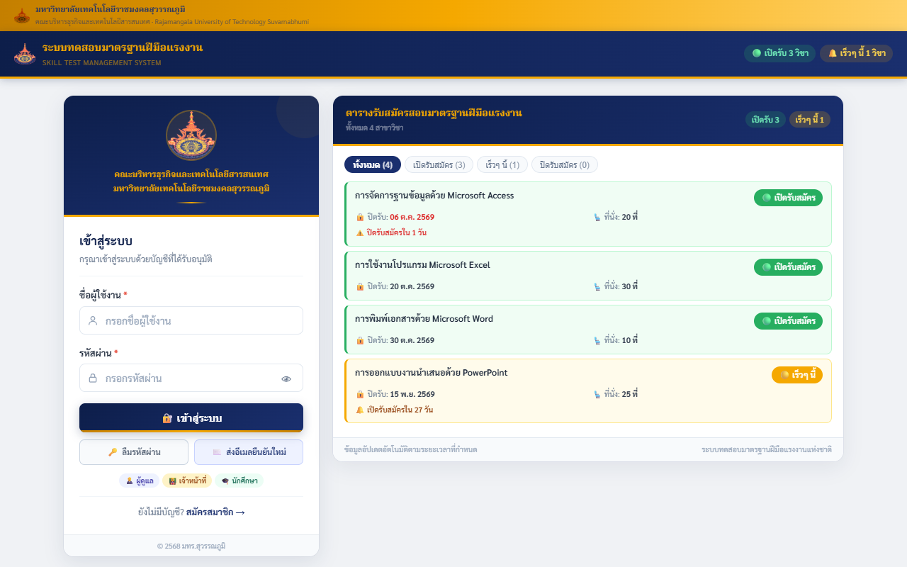

**วิธีเข้าสู่ระบบ**
1. กรอก **ชื่อผู้ใช้งาน** และ **รหัสผ่าน** (กดไอคอนรูปตาที่ช่องรหัสผ่านเพื่อแสดง/ซ่อนรหัส)
2. กดปุ่ม **เข้าสู่ระบบ**
3. ระบบพาไปหน้าแรกของบทบาทนั้นโดยอัตโนมัติ

ถ้าชื่อผู้ใช้หรือรหัสผ่านไม่ถูกต้อง จะแสดงข้อความสีแดง:

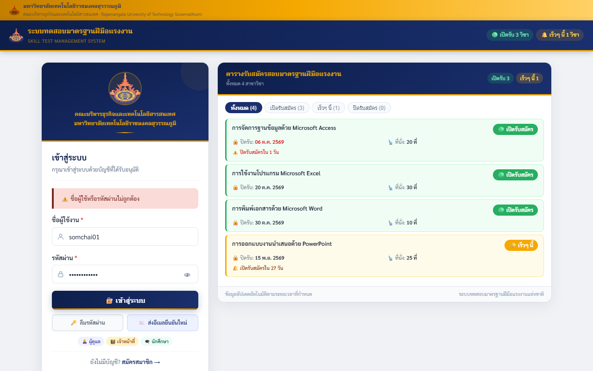

> **ความปลอดภัย:** ถ้าใส่รหัสผ่านผิดเกินจำนวนครั้งที่กำหนด (บัญชีเดียวกัน 10 ครั้งใน 15 นาที) ระบบจะหยุดรับชั่วคราวและแจ้งให้รอ 15 นาที การเข้าสู่ระบบที่ถูกต้องไม่ถูกนับรวม

ใต้ปุ่มมีทางลัด **ลืมรหัสผ่าน**, **ส่งอีเมลยืนยันใหม่** และลิงก์ **สมัครสมาชิก**

### 2.2 สมัครสมาชิก (นักศึกษาใหม่)

กด **สมัครสมาชิก →** ที่หน้าเข้าสู่ระบบ ฟอร์มมี 4 ขั้นตอน (แถบความคืบหน้าด้านบน)

#### ขั้นตอนที่ 1 — ข้อมูลส่วนตัว

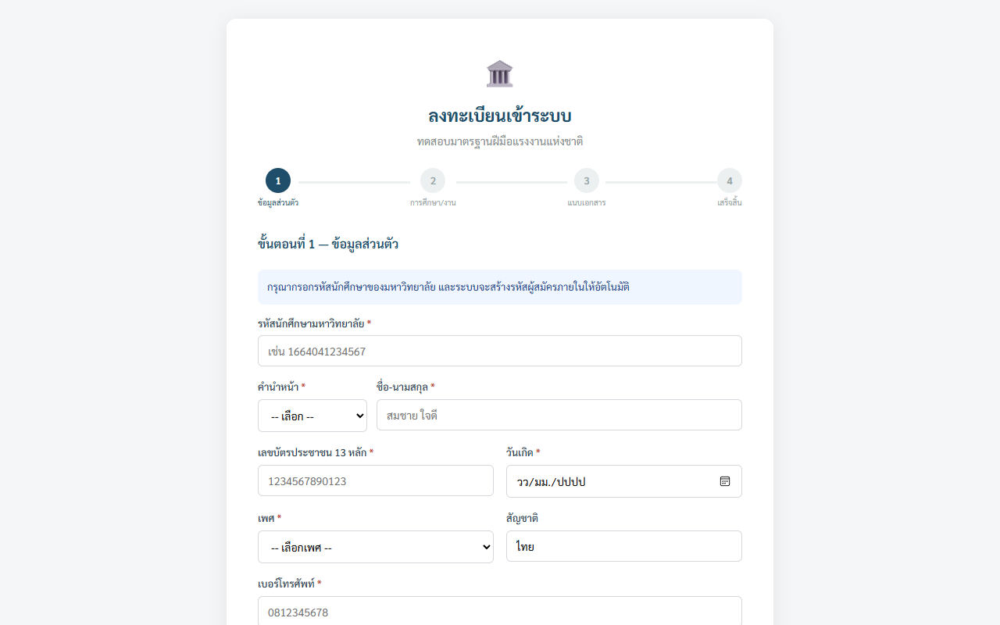

| ช่อง | คำอธิบาย |
|---|---|
| รหัสนักศึกษามหาวิทยาลัย | 4–30 ตัว ใช้ตัวอักษรอังกฤษ ตัวเลข หรือขีดกลาง (ระบบแปลงเป็นตัวพิมพ์ใหญ่ให้) |
| คำนำหน้า / ชื่อ-นามสกุล | เลือกคำนำหน้า (นาย / นาง / นางสาว) และกรอกชื่อ-นามสกุลจริง |
| เลขบัตรประชาชน 13 หลัก | ต้องเป็นเลขที่ถูกต้องตามหลักตรวจสอบ (check digit) ระบบจะแจ้งถ้าตัวเลขผิด |
| วันเกิด | ต้องเป็นวันที่ในอดีต |
| เพศ, สัญชาติ | เลือกเพศ (ชาย/หญิง/อื่นๆ) สัญชาติค่าเริ่มต้นคือ "ไทย" |
| เบอร์โทรศัพท์ | 10 หลัก ขึ้นต้นด้วย 0 |
| ที่อยู่ปัจจุบัน | ที่อยู่ที่ติดต่อได้ |

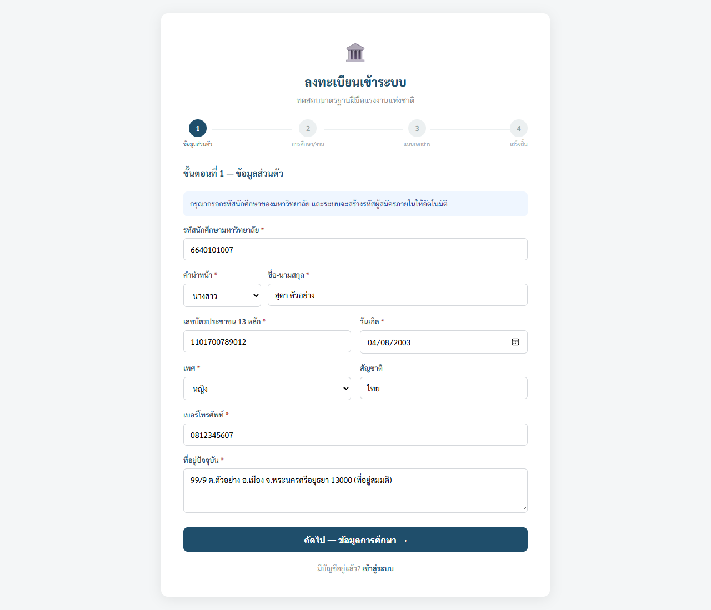

กด **ถัดไป — ข้อมูลการศึกษา →**

#### ขั้นตอนที่ 2 — การศึกษา/งาน และบัญชีผู้ใช้

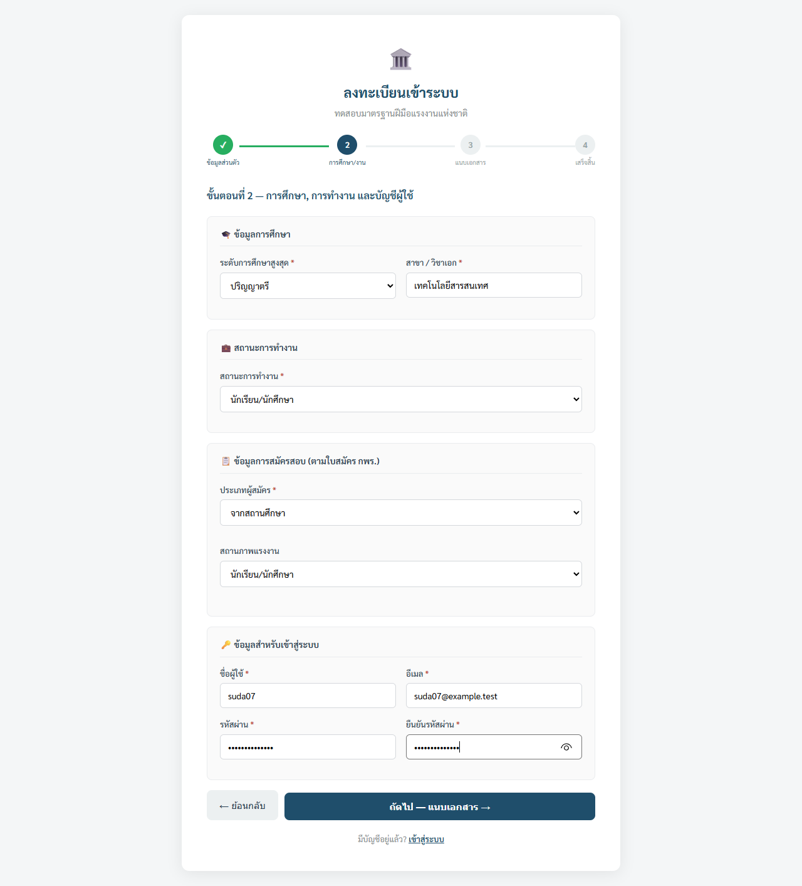

- **ข้อมูลการศึกษา:** ระดับการศึกษาสูงสุด และสาขา/วิชาเอก
- **สถานะการทำงาน:** เลือกสถานะ (ถ้าเลือก "ผู้มีงานทำ" จะมีช่องอาชีพ ประสบการณ์ และรายได้เพิ่ม)
- **ข้อมูลการสมัครสอบ:** ประเภทผู้สมัคร สถานภาพแรงงาน
- **ข้อมูลสำหรับเข้าสู่ระบบ:**
  - **ชื่อผู้ใช้** 4–50 ตัว ใช้ตัวอักษรอังกฤษ ตัวเลข จุด ขีดกลาง หรือขีดล่าง
  - **อีเมล** ต้องเป็นอีเมลที่ใช้งานได้จริง (ระบบส่งลิงก์ยืนยันไปที่นี่)
  - **รหัสผ่าน** อย่างน้อย 8 ตัวอักษร (ไม่เกิน 72 ไบต์ ตัวอักษรไทย 1 ตัว = 3 ไบต์) และกรอกยืนยันอีกครั้ง

#### ขั้นตอนที่ 3 — แนบเอกสาร

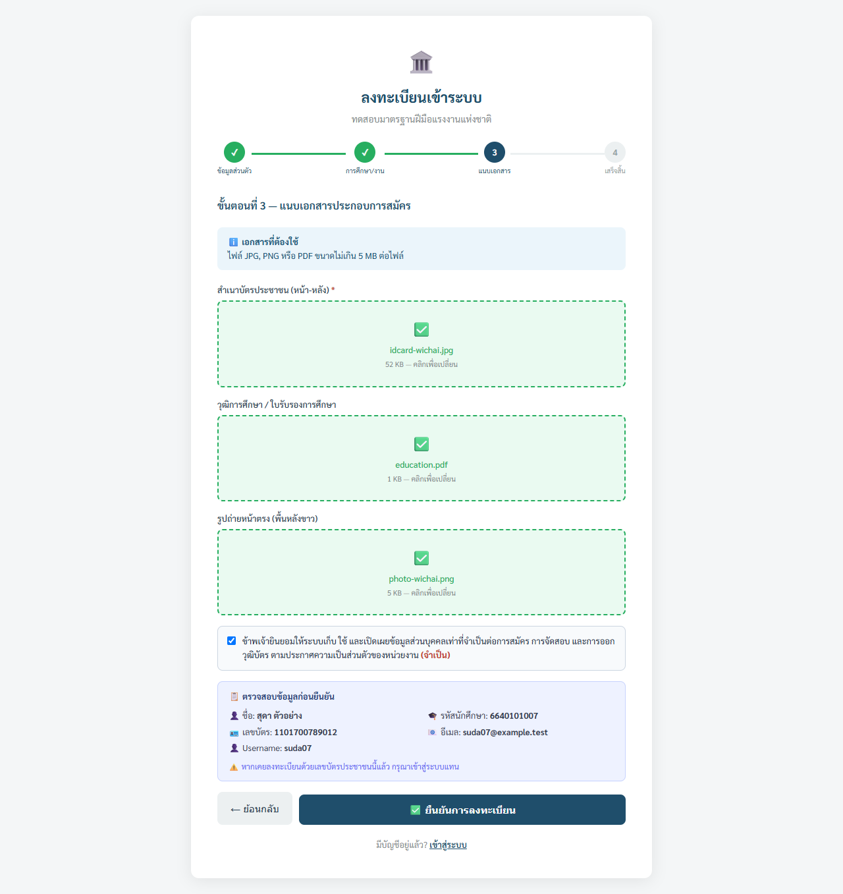

1. แนบ **สำเนาบัตรประชาชน** (บังคับ) โดยคลิกกรอบหรือลากไฟล์มาวาง
2. แนบ **วุฒิการศึกษา/ใบรับรองการศึกษา** และ **รูปถ่ายหน้าตรง (พื้นหลังขาว)** (ไม่บังคับ แต่ควรแนบ เพราะรูปถ่ายจะแสดงบนใบรับรอง)
3. ติ๊กช่อง **ยินยอมให้เก็บ ใช้ และเปิดเผยข้อมูลส่วนบุคคล** (จำเป็น)
4. ตรวจสอบข้อมูลสรุปด้านล่างอีกครั้ง แล้วกด **ยืนยันการลงทะเบียน**

> ถ้าไฟล์ผิดชนิดหรือใหญ่เกิน 5 MB ระบบจะแจ้งและไม่บันทึก ให้เลือกไฟล์ใหม่

#### ขั้นตอนที่ 4 — เสร็จสิ้น

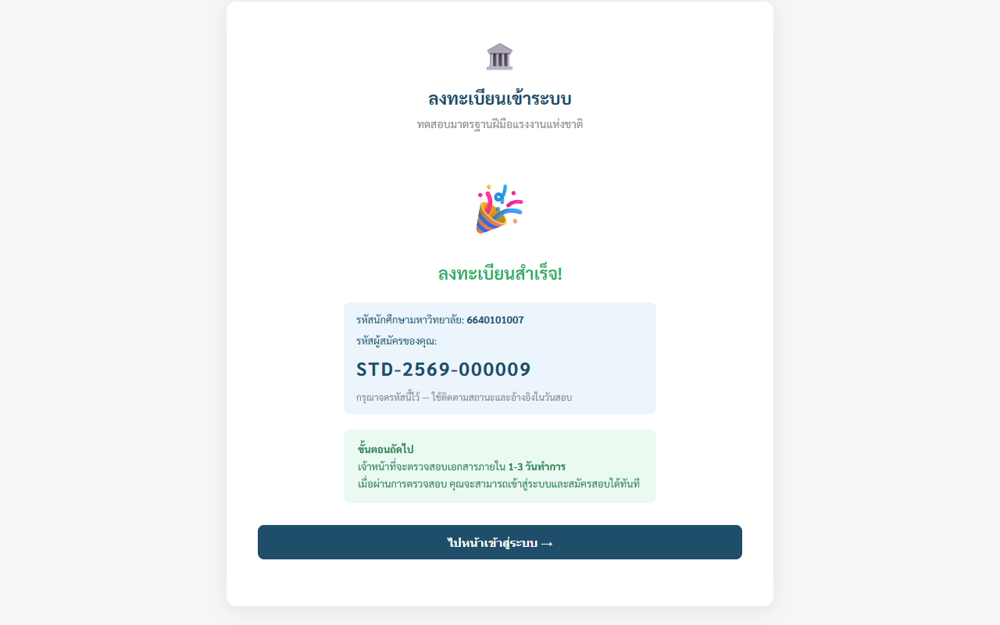

ระบบแสดง **รหัสผู้สมัคร** (รูปแบบ `STD-ปี พ.ศ.-ตัวเลข`) ให้จดไว้ ใช้อ้างอิงเมื่อติดต่อเจ้าหน้าที่ จากนั้นให้ **ตรวจอีเมลเพื่อกดลิงก์ยืนยันบัญชี** (ลิงก์ใช้ได้ 24 ชั่วโมง) แล้วรอเจ้าหน้าที่ตรวจเอกสารภายใน 1–3 วันทำการ

### 2.3 ยืนยันอีเมล

กดลิงก์ในอีเมลที่ระบบส่งให้ ระบบจะแสดงผลการยืนยัน:

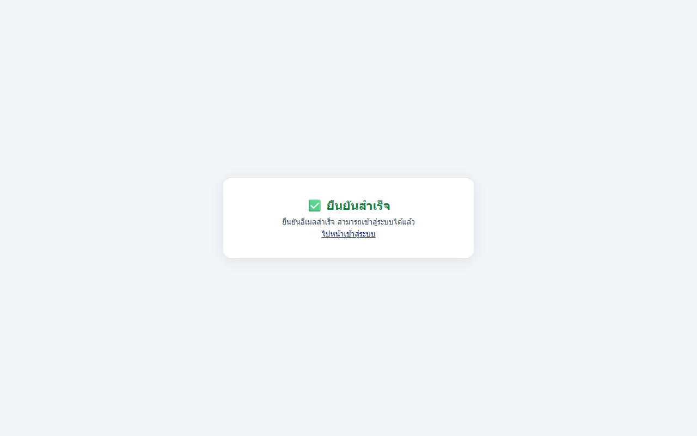

ถ้าลิงก์หมดอายุหรือถูกใช้ไปแล้ว:

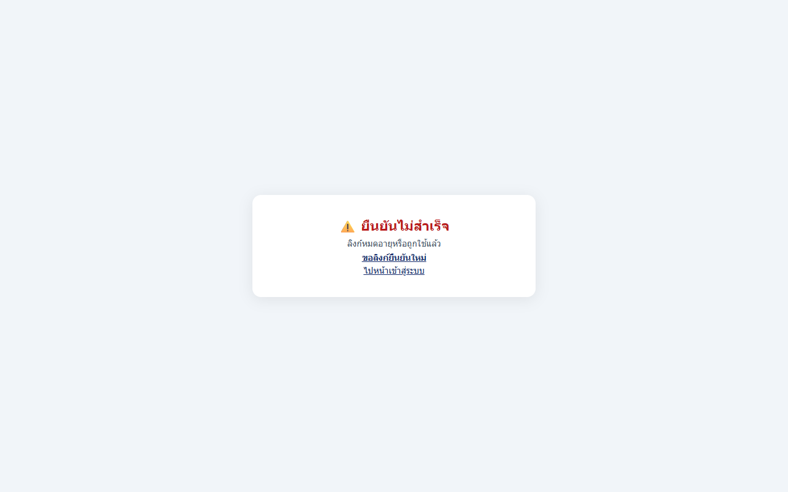

กด **ขอลิงก์ยืนยันใหม่** เพื่อไปหน้าขอส่งอีเมลยืนยันอีกครั้ง

### 2.4 ส่งอีเมลยืนยันใหม่

ใช้เมื่ออีเมลยืนยันไม่มา หรือลิงก์หมดอายุ

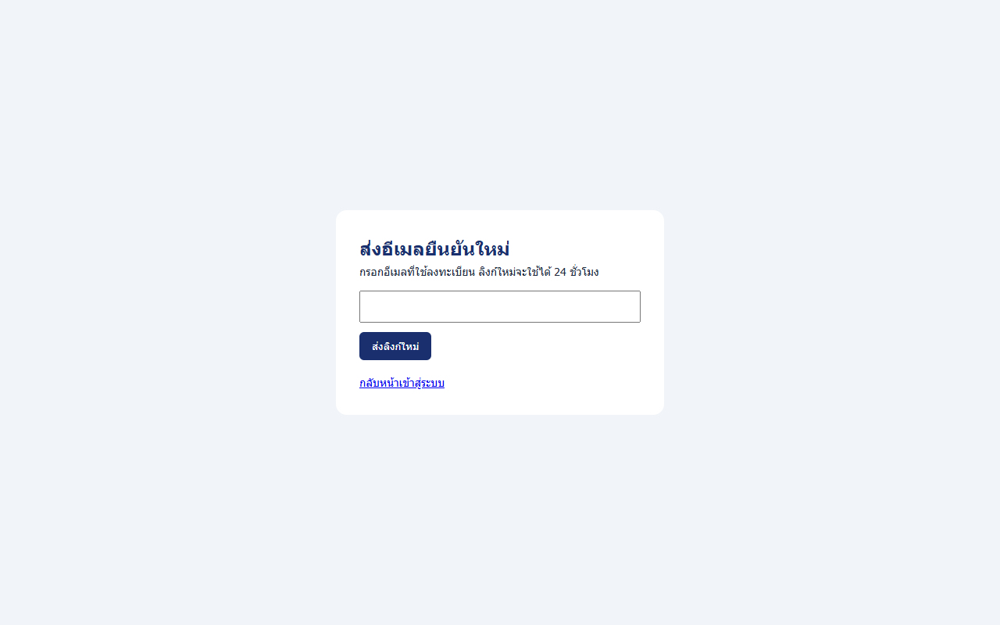

กรอกอีเมลที่ใช้สมัคร แล้วกด **ส่งลิงก์ใหม่** (ระบบตอบข้อความเดียวกันเสมอเพื่อความปลอดภัย และส่งได้ไม่เกินนาทีละครั้งต่อบัญชี ตรวจโฟลเดอร์สแปมด้วย)

### 2.5 ลืมรหัสผ่าน

1. กด **ลืมรหัสผ่าน** ที่หน้าเข้าสู่ระบบ กรอกอีเมลที่ลงทะเบียนไว้ แล้วกด **ส่งลิงก์**

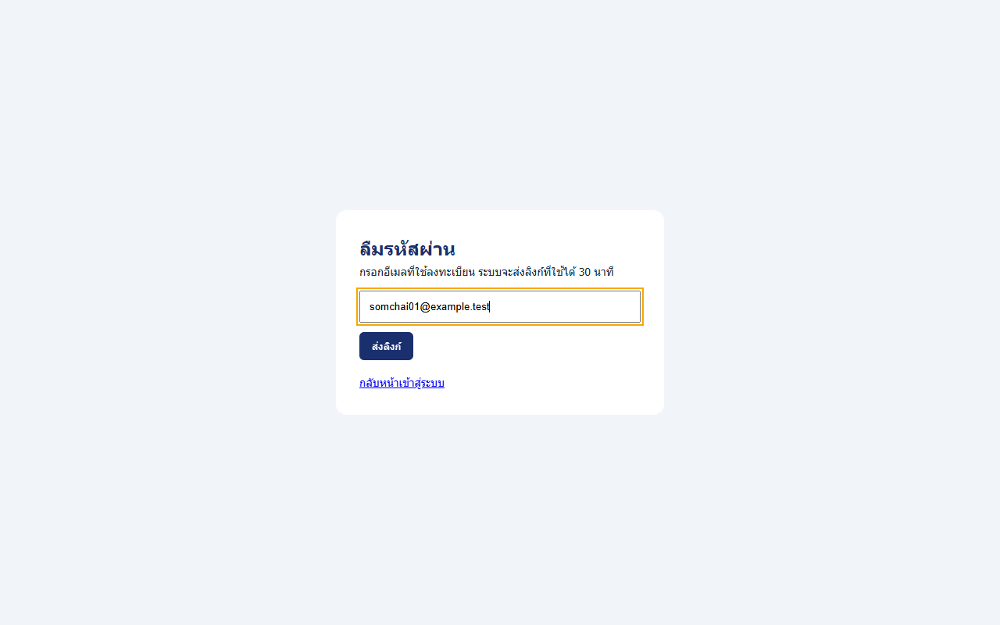

2. ระบบแจ้งว่า "หากอีเมลนี้มีในระบบ ระบบจะส่งลิงก์ตั้งรหัสผ่านใหม่ให้"

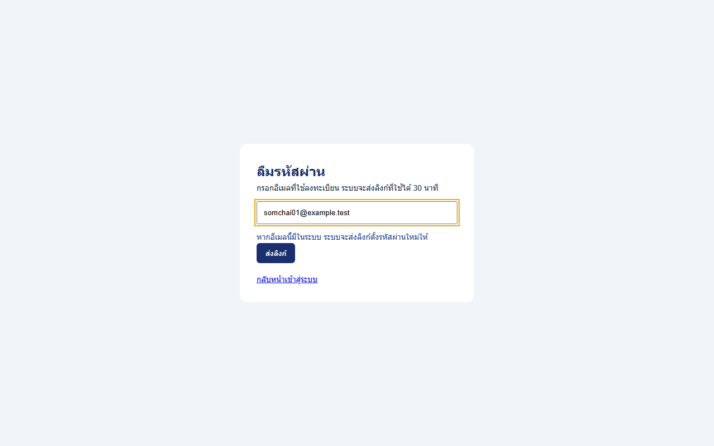

3. เปิดอีเมลแล้วกดลิงก์ **ตั้งรหัสผ่านใหม่** (ใช้ได้ **30 นาที** และใช้ได้ครั้งเดียว) กรอกรหัสผ่านใหม่สองครั้ง แล้วกด **บันทึกรหัสผ่าน**

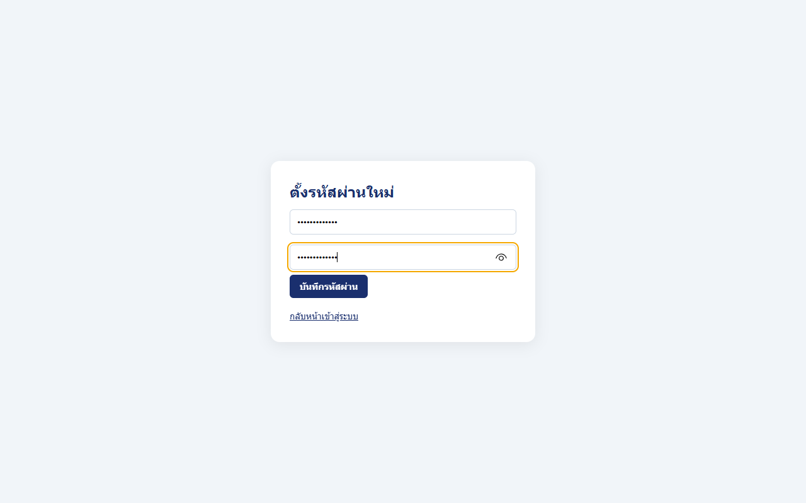

> เมื่อรหัสผ่านถูกเปลี่ยน ทุกเครื่องที่เคยเข้าสู่ระบบอยู่จะถูกออกจากระบบ ต้องเข้าสู่ระบบใหม่

### 2.6 ตรวจสอบใบรับรอง (สาธารณะ)

บุคคลภายนอก (เช่น นายจ้าง) ตรวจสอบความถูกต้องของใบรับรองได้โดยเปิดลิงก์ที่พิมพ์อยู่ท้ายใบรับรอง (`.../verify-certificate/รหัสตรวจสอบ`) ไม่ต้องเข้าสู่ระบบ

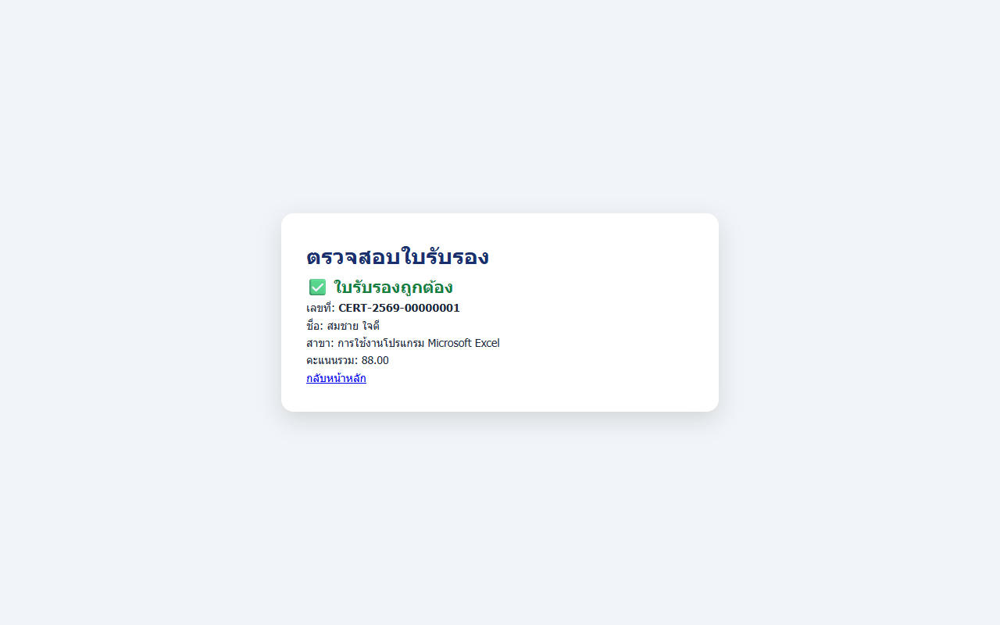

หน้านี้แสดงเลขที่ใบรับรอง ชื่อผู้ได้รับ สาขา และคะแนนรวม เท่านั้น (ไม่แสดงเลขบัตรประชาชน) ถ้าใบรับรองถูกเพิกถอน จะแสดงว่า "ใบรับรองถูกเพิกถอน"

---

## 3. สำหรับนักศึกษา

### 3.1 แดชบอร์ดนักศึกษา

หลังเข้าสู่ระบบ จะพบหน้าแดชบอร์ด

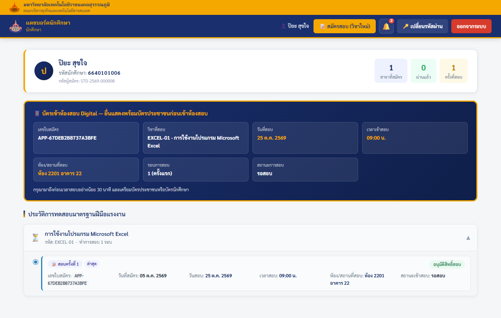

ส่วนต่างๆ ของหน้า:
- **แถบด้านบน** มีปุ่ม **สมัครสอบ (วิชาใหม่)**, **ไอคอนกระดิ่ง** (การแจ้งเตือน), **เปลี่ยนรหัสผ่าน**, **ออกจากระบบ** (ถ้าเอกสารยังไม่ครบจะมีปุ่ม **ส่งเอกสารใหม่** เพิ่มขึ้นมา)
- **การ์ดข้อมูลนักศึกษา** แสดงชื่อ รหัสนักศึกษา รหัสผู้สมัคร และสรุป: จำนวนสาขาที่สมัคร / ผ่านแล้ว / ครั้งที่สอบ
- **บัตรเข้าห้องสอบ Digital** (กรอบสีน้ำเงิน-ทอง) จะปรากฏเมื่อ **ใบสมัครได้รับอนุมัติแล้วและยังไม่ประกาศผล** แสดงเลขใบสมัคร วิชา วัน เวลา ห้องสอบ รอบ และสถานะ ให้เปิดแสดงพร้อมบัตรประชาชนก่อนเข้าห้องสอบ และมาถึงก่อนเวลาอย่างน้อย 30 นาที
- **ประวัติการทดสอบ** แยกตามวิชา แต่ละวิชามีไทม์ไลน์ทุกครั้งที่สอบ (คลิกหัวข้อเพื่อย่อ/ขยาย)

### 3.2 การแจ้งเตือน (ไอคอนกระดิ่ง)

กดไอคอนกระดิ่งเพื่อดูการแจ้งเตือน ตัวเลขสีแดงคือจำนวนที่ยังไม่ได้อ่าน

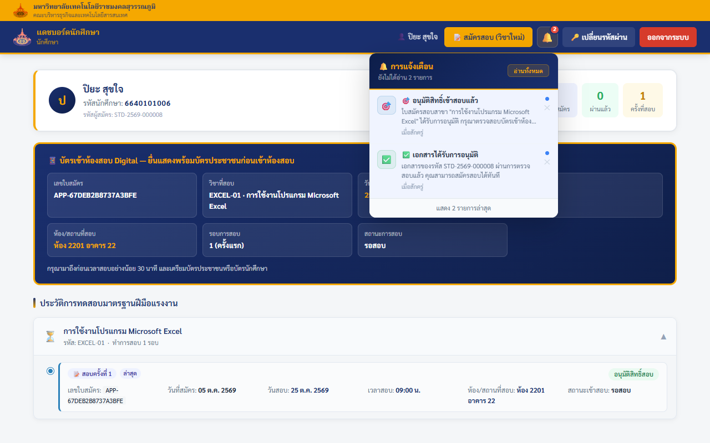

ระบบแจ้งเตือนเมื่อ: เอกสารได้รับการอนุมัติ / เอกสารไม่ครบ (พร้อมหมายเหตุ) / ใบสมัครสอบได้รับอนุมัติหรือถูกปฏิเสธ / ประกาศผลสอบหรือมีการแก้ไขผล
- คลิกที่รายการเพื่ออ่านและไปยังหน้าที่เกี่ยวข้อง
- **อ่านทั้งหมด** ทำเครื่องหมายว่าอ่านแล้วทุกรายการ, **✕** ลบรายการนั้น
- ระบบแสดง 30 รายการล่าสุด และโหลดใหม่ทุก 1 นาที (สำคัญๆ ยังส่งทางอีเมลด้วย)

### 3.3 สมัครสอบ

> **เงื่อนไข:** เอกสารต้องได้รับการอนุมัติจากเจ้าหน้าที่ก่อน

1. กดปุ่ม **สมัครสอบ (วิชาใหม่)**
2. เลือกสาขาจากรายการ (แสดงเฉพาะวิชาที่เปิดรับสมัครอยู่ วิชาที่ปิดจะแสดงเป็นข้อความเตือนด้านล่าง)
3. กด **ยืนยันการส่งใบสมัคร**

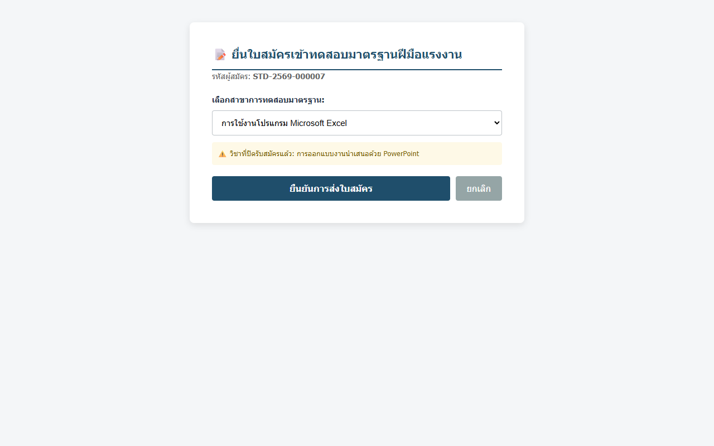

ระบบแจ้งว่า "ยื่นใบสมัครสำเร็จ กรุณารอการอนุมัติสิทธิ์" และส่งอีเมลยืนยันว่าได้รับใบสมัครแล้ว (ยังไม่ใช่การอนุมัติสิทธิ์สอบ) จากนั้นรอเจ้าหน้าที่อนุมัติ เมื่ออนุมัติแล้วจะได้การแจ้งเตือนและ **บัตรเข้าห้องสอบ Digital** บนแดชบอร์ด

ถ้าเอกสารยังไม่ได้รับการอนุมัติ ปุ่มยืนยันจะกดไม่ได้ และมีข้อความสีแดงแจ้ง:

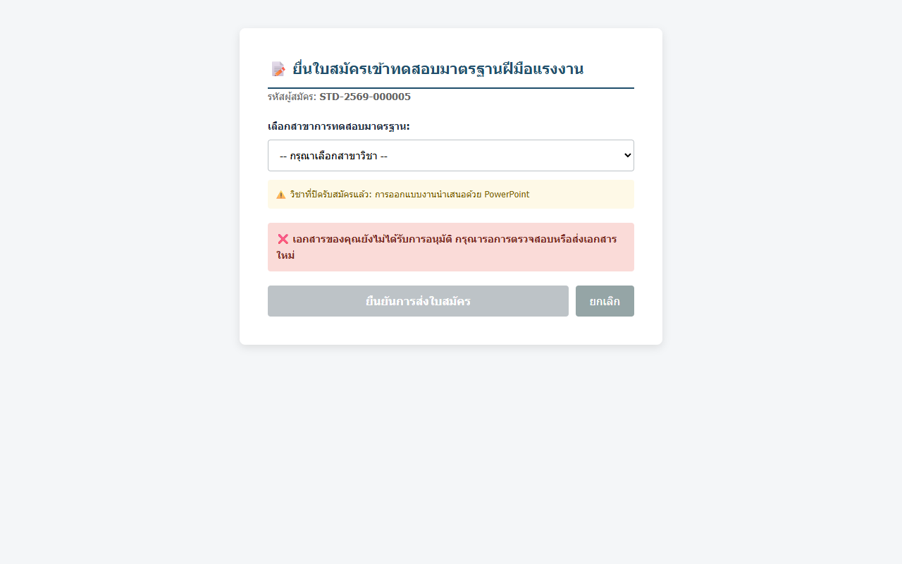

**สมัครไม่ได้ในกรณีเหล่านี้** (ระบบจะแจ้งข้อความ): วิชาไม่อยู่ในช่วงเปิดรับสมัคร, จำนวนผู้สมัครเต็มแล้ว, คุณมีใบสมัครวิชานี้อยู่แล้ว, วิชานั้นผ่านวันสอบไปแล้ว

### 3.4 ส่งเอกสารใหม่ (เมื่อเจ้าหน้าที่แจ้งว่าเอกสารไม่ครบ)

เมื่อเจ้าหน้าที่ตรวจแล้วพบว่าเอกสารไม่ครบหรือไม่ชัด นักศึกษาจะได้การแจ้งเตือนพร้อมหมายเหตุ และบนแดชบอร์ดจะมีปุ่ม **ส่งเอกสารใหม่**

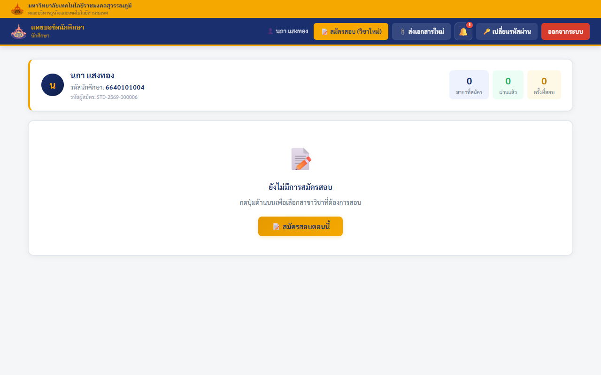

1. กดปุ่ม **ส่งเอกสารใหม่**
2. เลือก **เฉพาะเอกสารที่ต้องการแก้ไข** (สำเนาบัตร / เอกสารการศึกษา / รูปถ่าย) อย่างน้อยหนึ่งไฟล์
3. กด **ยืนยันส่งเอกสาร**

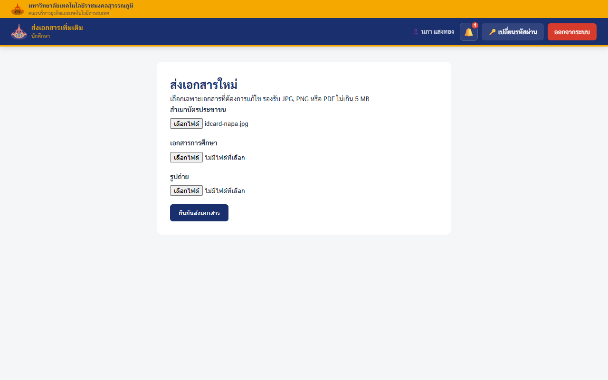

สถานะจะกลับเป็น "รอตรวจสอบเอกสาร" เพื่อให้เจ้าหน้าที่ตรวจใหม่ (ระบบเก็บประวัติเอกสารทุกเวอร์ชัน) ปุ่มนี้ใช้ได้เฉพาะเมื่อสถานะเป็น "เอกสารไม่ครบ" เท่านั้น

### 3.5 ใบสมัครที่รอการอนุมัติ

หลังสมัครสอบแล้วและยังไม่ได้รับอนุมัติ ในประวัติจะแสดงสถานะ **รอดำเนินการ**

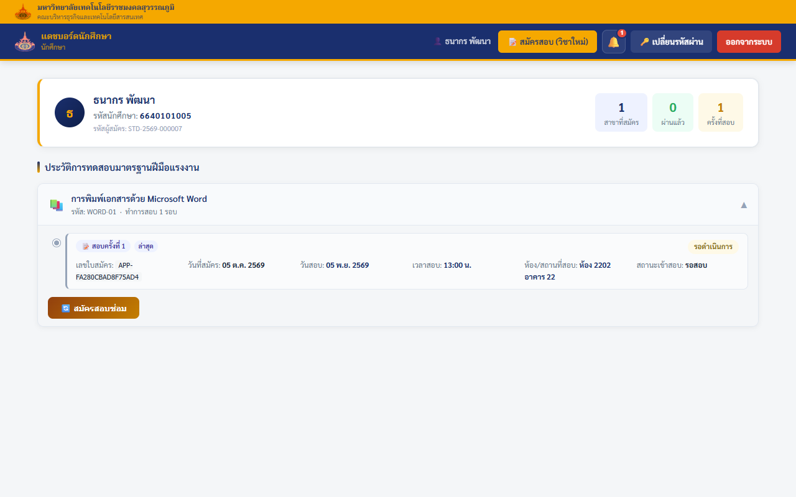

### 3.6 ดูผลสอบและเปิดใบรับรอง

เมื่อเจ้าหน้าที่ประกาศผล จะมีการแจ้งเตือนและอีเมล ผลคะแนนปรากฏในประวัติ (ทฤษฎี / ปฏิบัติ / รวม และผลการประเมิน)

**กรณีผ่านเกณฑ์** (คะแนนสุทธิ ≥ 70):

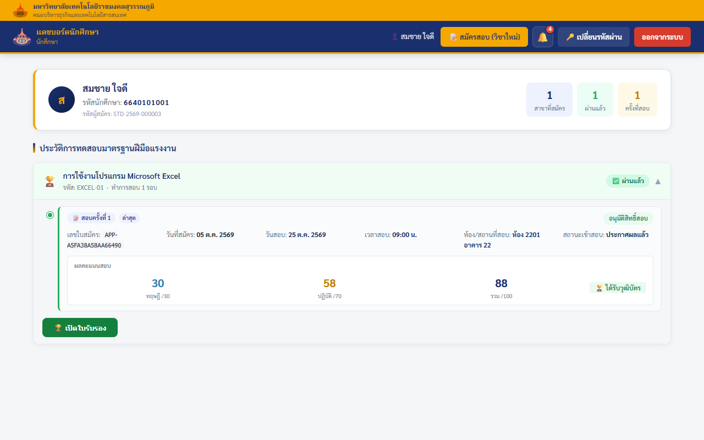

กดปุ่ม **เปิดใบรับรอง** ระบบเปิดหน้าต่างใหม่ (ต้องอนุญาต popup) แสดงใบรับรอง กดพิมพ์ (Ctrl+P) แล้วเลือก "Save as PDF" หรือส่งไปเครื่องพิมพ์ได้

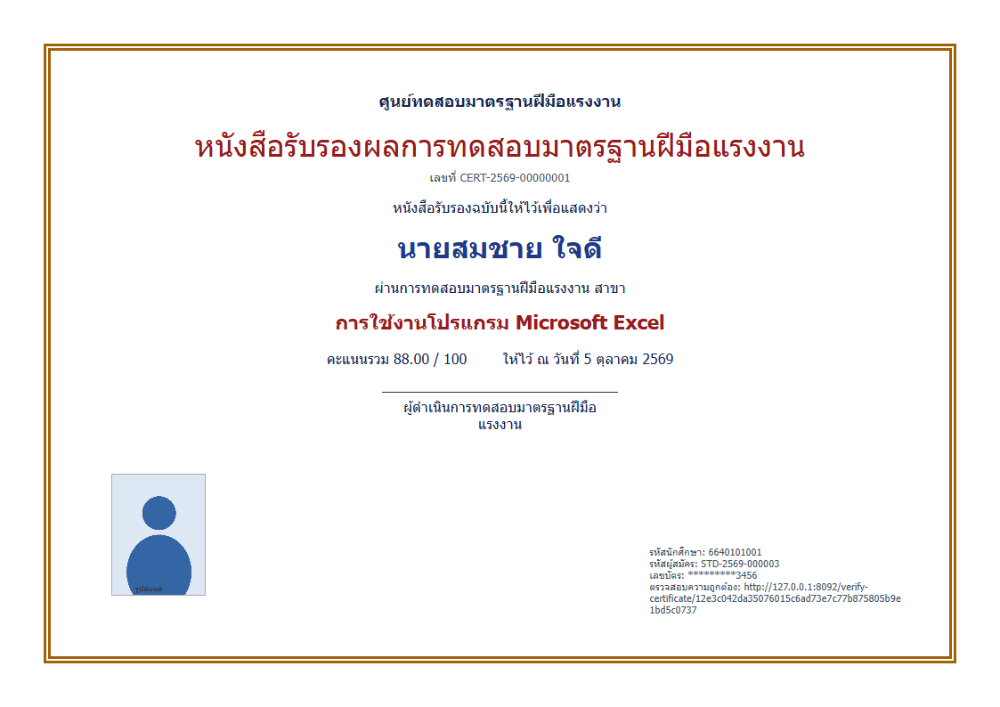

ใบรับรองมีเลขที่ ชื่อ สาขา คะแนน วันที่ให้ รูปถ่าย (ถ้าแนบไว้) เลขบัตรที่ปิดบังบางส่วน และลิงก์สำหรับตรวจสอบความถูกต้อง ใบรับรองที่ถูกเพิกถอนจะเปิดไม่ได้

### 3.7 สมัครสอบซ่อม

**กรณีไม่ผ่านเกณฑ์** จะมีปุ่ม **สมัครสอบซ่อม** ใต้ประวัติของวิชานั้น

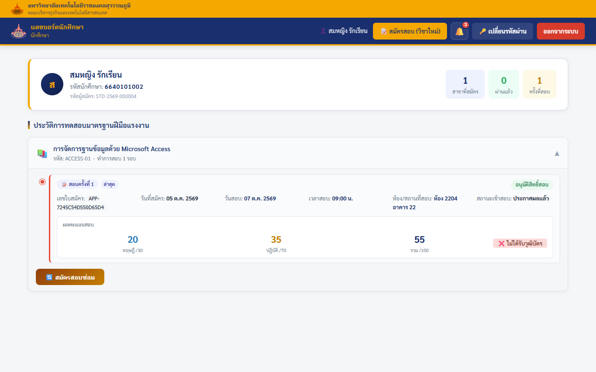

1. กด **สมัครสอบซ่อม**
2. (ไม่บังคับ) พิมพ์เหตุผลในการสอบซ่อม
3. กด **ยืนยันสมัครสอบซ่อม**

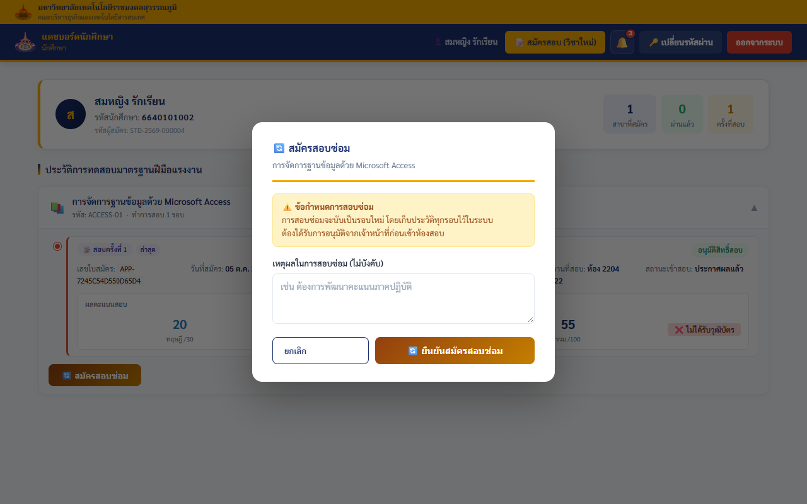

เงื่อนไข: ผลครั้งก่อนต้องประกาศแล้วและไม่ผ่าน, ยังไม่เกินจำนวนครั้งสอบสูงสุดของวิชา, วิชายังเปิดรับสมัครและยังไม่ผ่านวันสอบ การสอบซ่อมนับเป็นรอบใหม่ (เก็บประวัติทุกรอบ) และต้องได้รับอนุมัติจากเจ้าหน้าที่ก่อนเข้าสอบ

### 3.8 เปลี่ยนรหัสผ่าน

กด **เปลี่ยนรหัสผ่าน** ที่แถบด้านบน กรอกรหัสผ่านเดิม รหัสผ่านใหม่ และยืนยันรหัสผ่านใหม่ (แถบความแข็งแกร่งช่วยประเมิน)

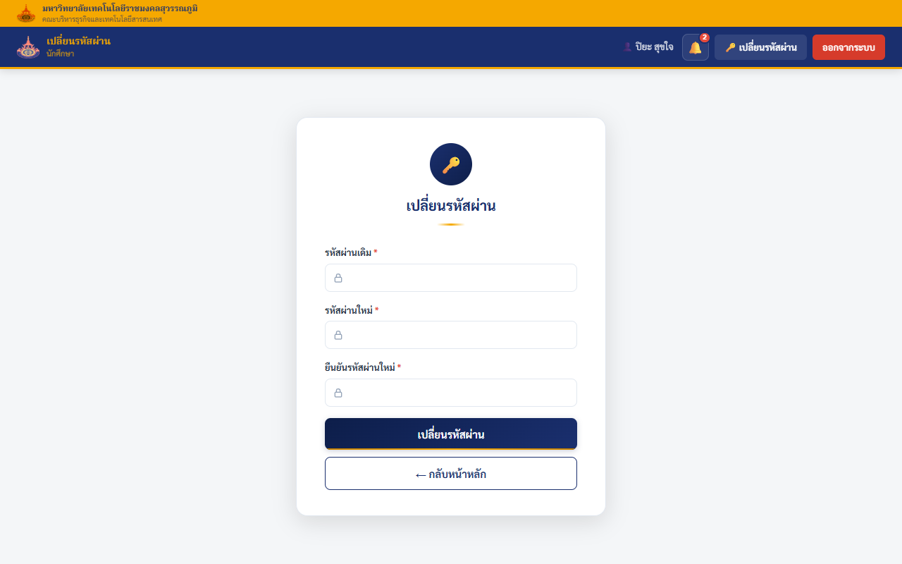

เมื่อสำเร็จ ระบบจะออกจากระบบทุกเครื่อง ต้องเข้าสู่ระบบใหม่ด้วยรหัสผ่านใหม่ (รหัสใหม่ต้องไม่ซ้ำรหัสเดิม)

---

## 4. สำหรับเจ้าหน้าที่/อาจารย์

เจ้าหน้าที่เข้าสู่ระบบแล้วจะพบ **แผงควบคุมเจ้าหน้าที่** (บัญชีเจ้าหน้าที่สร้างโดยผู้ดูแลระบบ/ฝ่ายเทคนิค ไม่มีการสมัครเอง) แถบด้านบนมีทางลัด: **ข้อมูลนักศึกษา**, **ส่งออกข้อมูล**, **ตรวจสอบเอกสาร (จำนวนที่รอ)**

### 4.1 แผงควบคุม: คัดกรองใบสมัคร

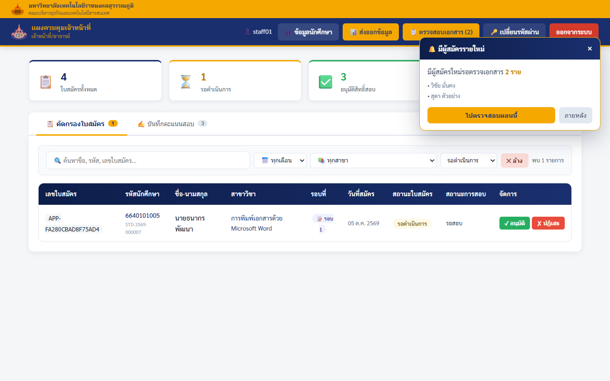

- **การ์ดสรุปด้านบน:** ใบสมัครทั้งหมด / รอดำเนินการ / อนุมัติสิทธิ์สอบ / ประกาศผลแล้ว
- **ป้ายแจ้งเตือนมุมขวาบน** "มีผู้สมัครรายใหม่" ปรากฏเมื่อมีผู้สมัครใหม่รอตรวจเอกสาร (ระบบตรวจทุก 30 วินาที) กด **ไปตรวจสอบตอนนี้** เพื่อไปหน้าตรวจเอกสาร
- **ตัวกรอง:** ค้นหาชื่อ/รหัส/เลขใบสมัคร, เดือน, สาขา, สถานะ (กด **✕ ล้าง** เพื่อล้างตัวกรอง) ตารางแสดงหน้าละ 10 รายการ

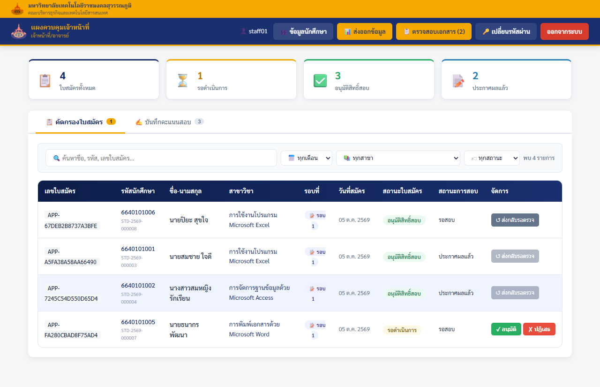

**การจัดการใบสมัคร**
- ใบสมัครที่ **รอดำเนินการ** มีปุ่ม **✓ อนุมัติ** และ **✗ ปฏิเสธ**
- ใบสมัครที่ตัดสินแล้วมีปุ่ม **↺ ส่งกลับรอตรวจ** (ใช้ไม่ได้ถ้าประกาศผลไปแล้ว)
- ทุกครั้งที่เปลี่ยนสถานะ ระบบถามยืนยัน แจ้งเตือนนักศึกษา และส่งอีเมล (ถ้ากดสถานะเดิมซ้ำจะไม่ส่งซ้ำ)
- การนำใบสมัครที่ถูกปฏิเสธกลับมา ระบบตรวจจำนวนที่นั่งก่อน ถ้าที่นั่งเต็มจะไม่อนุญาต

### 4.2 แผงควบคุม: บันทึกคะแนนสอบ

กดแท็บ **บันทึกคะแนนสอบ** แสดงใบสมัครที่ได้รับอนุมัติสิทธิ์สอบแล้วเป็นการ์ด แบ่ง 3 ขั้นตอน: **1) ยืนยันการเข้าสอบ → 2) กรอกคะแนนในหน้าต่าง → 3) ตรวจคะแนนและประกาศผล** (เกณฑ์ผ่าน: คะแนนสุทธิ ≥ 70)

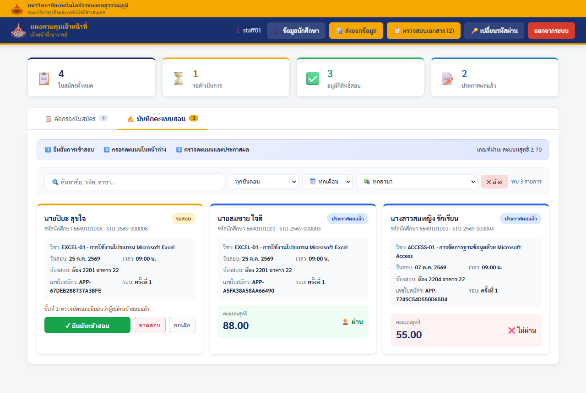

ตัวกรอง "ทุกขั้นตอน" แยกงานได้: งานที่ยังไม่ประกาศผล / รอยืนยันเข้าสอบ / พร้อมกรอกคะแนน / ขาดสอบ-ยกเลิก / ประกาศผลแล้ว

**ขั้นที่ 1 ในวันสอบ** ตรวจบัตรและกดสถานะของผู้สมัคร:
- **✓ ยืนยันเข้าสอบ** (ต้องทำก่อนจึงจะกรอกคะแนนได้)
- **ขาดสอบ** หรือ **ยกเลิก**
- ถ้ากดผิด ใช้ปุ่ม **แก้สถานะ / แก้เป็นรอสอบ** ได้ก่อนประกาศผล

**ขั้นที่ 2** กด **เปิดหน้าต่างกรอกคะแนน**

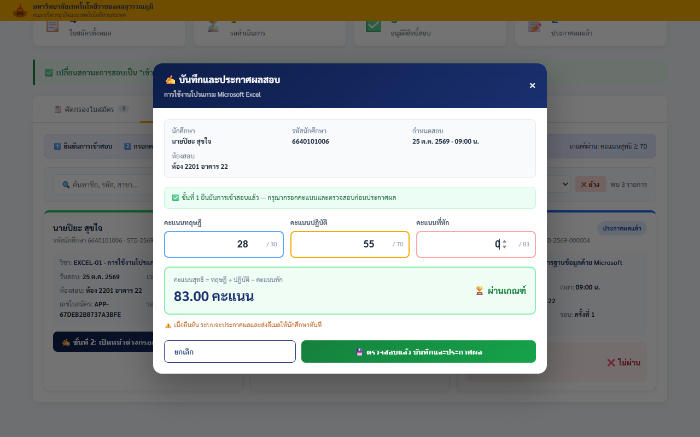

| ช่อง | กติกา |
|---|---|
| คะแนนทฤษฎี | 0 ถึงคะแนนเต็มของวิชา (ค่าเริ่มต้น 30) |
| คะแนนปฏิบัติ | 0 ถึงคะแนนเต็มของวิชา (ค่าเริ่มต้น 70) |
| คะแนนที่หัก | ไม่ติดลบ และไม่เกินผลรวมทฤษฎี + ปฏิบัติ |

ทศนิยมได้ไม่เกิน 2 ตำแหน่ง ระบบคำนวณ **คะแนนสุทธิ = ทฤษฎี + ปฏิบัติ − คะแนนที่หัก** ให้ทันทีและบอกว่าผ่านเกณฑ์หรือไม่

**ขั้นที่ 3** ตรวจทานแล้วกด **ตรวจสอบแล้ว บันทึกและประกาศผล** (ระบบถามยืนยันอีกครั้ง)

> ⚠️ **ประกาศผลแล้วแก้ไม่ได้ด้วยบัญชีเจ้าหน้าที่** การกดยืนยันจะบันทึกคะแนน ประกาศผล และส่งอีเมลให้นักศึกษาทันที หากพบว่าคะแนนที่ประกาศผิดพลาด ให้แจ้งผู้ดูแลระบบเพื่อแก้ไขพร้อมเหตุผล (ดูหัวข้อ 5.6)

### 4.3 ตรวจสอบเอกสารผู้สมัคร

กดปุ่ม **ตรวจสอบเอกสาร** ที่แถบด้านบน แสดงผู้สมัครที่รอตรวจ (รอตรวจสอบเอกสาร และเอกสารไม่ครบ) เรียงจากสมัครก่อน

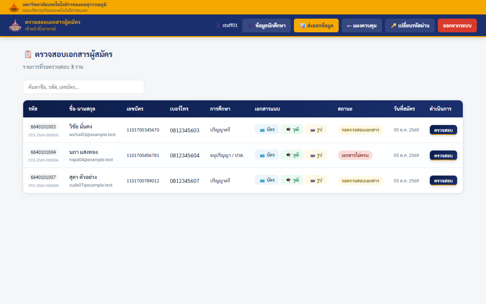

1. กดปุ่ม **ตรวจสอบ** ที่แถวของผู้สมัคร จะเปิดหน้าต่างพร้อมข้อมูลผู้สมัคร

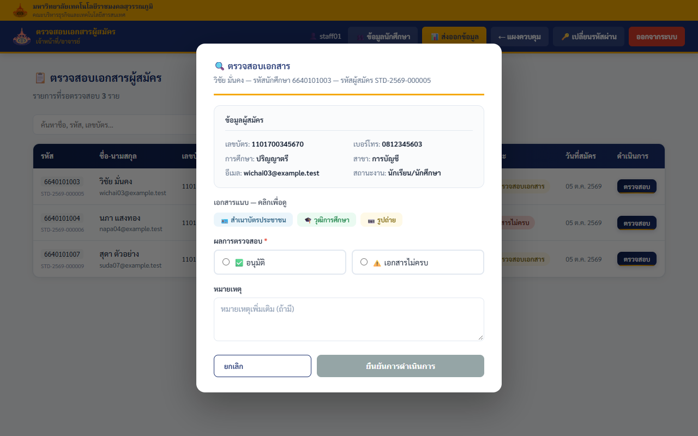

2. กดปุ่มเอกสาร (**สำเนาบัตรประชาชน / วุฒิการศึกษา / รูปถ่าย**) เพื่อเปิดดู รองรับทั้งภาพและ PDF (ปุ่ม **เปิดในแท็บใหม่** ใช้ขยายดู) เปรียบเทียบข้อมูลกับที่ผู้สมัครกรอก

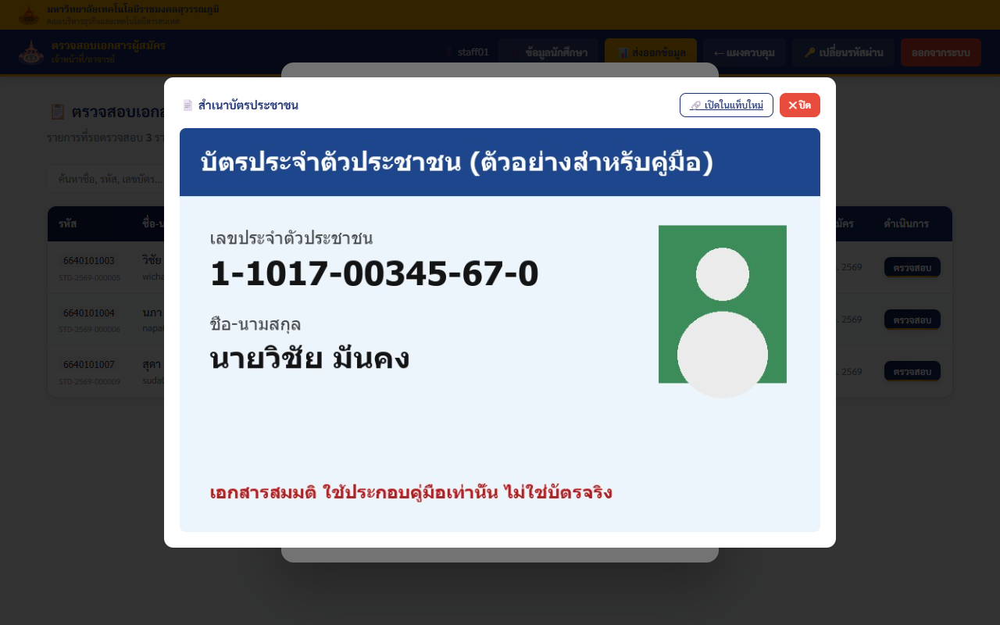

3. เลือก **ผลการตรวจสอบ**:
   - **อนุมัติ** — ผู้สมัครสมัครสอบได้ทันที
   - **เอกสารไม่ครบ** — ต้องระบุ **หมายเหตุ** ว่าขาด/ไม่ชัดอะไร ผู้สมัครจะได้รับแจ้งและส่งเอกสารใหม่ได้
4. กด **ยืนยันการดำเนินการ**

ระบบส่งการแจ้งเตือนและอีเมลให้นักศึกษาอัตโนมัติ ทุกครั้งที่เจ้าหน้าที่เปิดดูเอกสาร ระบบบันทึกไว้ใน Audit Log (ใคร เปิดไฟล์ไหน เมื่อไร)

### 4.4 ข้อมูลนักศึกษา

กดปุ่ม **ข้อมูลนักศึกษา** ที่แถบด้านบน ค้นหานักศึกษาทั้งระบบได้

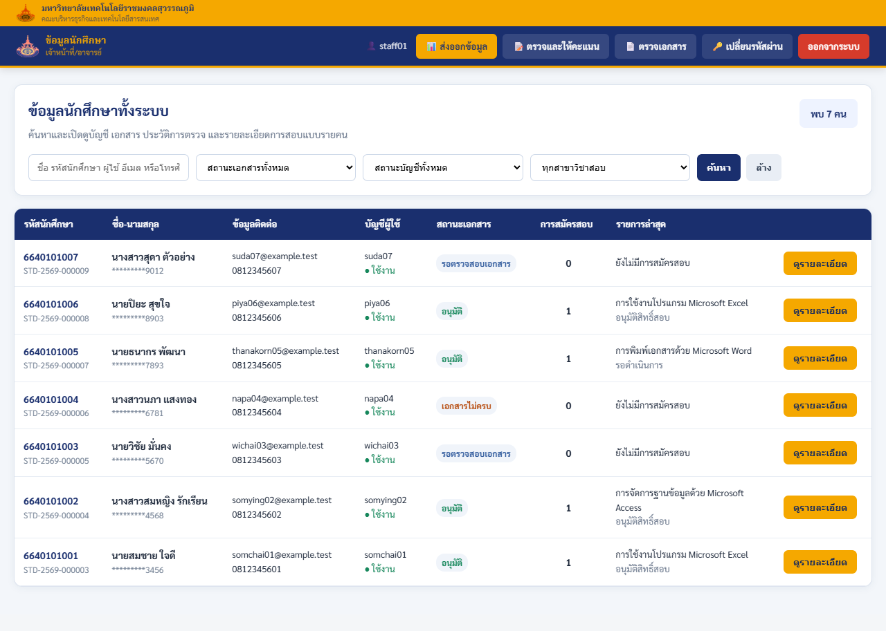

- ค้นหาด้วยชื่อ รหัสนักศึกษา ชื่อผู้ใช้ อีเมล หรือเบอร์โทร และกรองตามสถานะเอกสาร / สถานะบัญชี / สาขาที่สอบ
- เลขบัตรประชาชนในรายการถูกปิดบังไว้ (แสดงเฉพาะ 4 ตัวท้าย)
- กด **ดูรายละเอียด** เพื่อเปิดแฟ้มรายคน

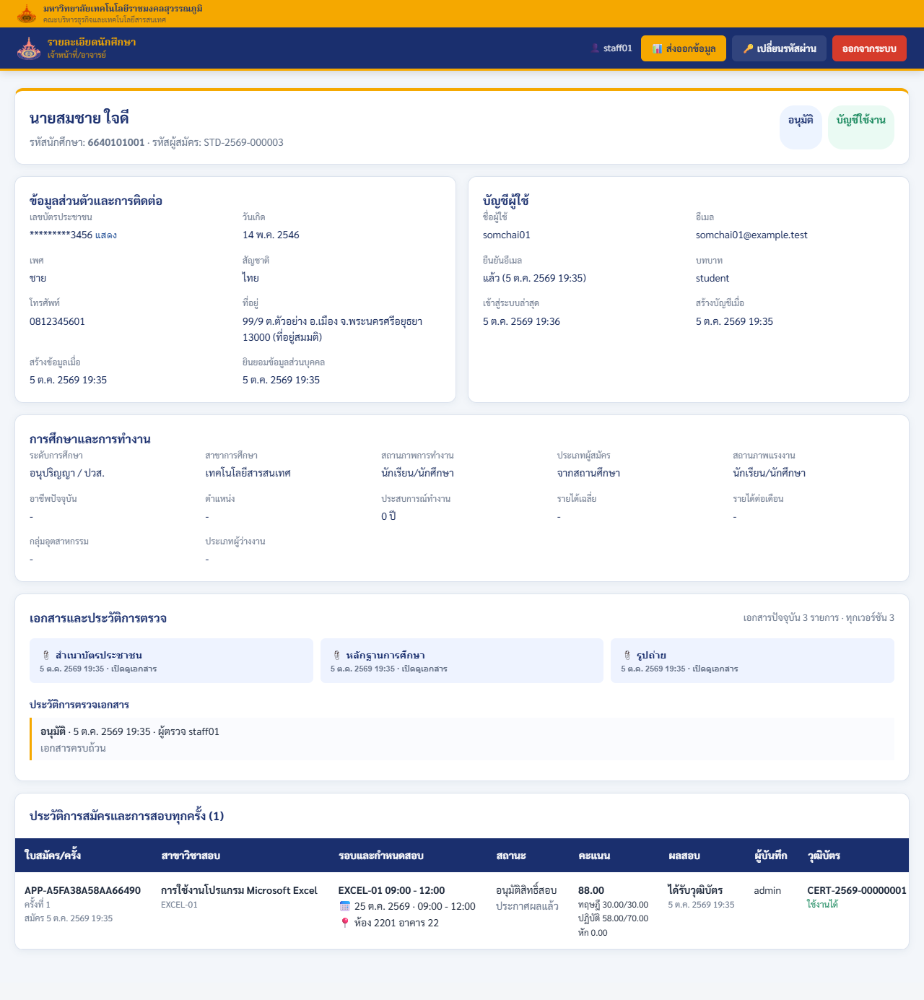

หน้ารายละเอียดมี: ข้อมูลส่วนตัว บัญชีผู้ใช้ การศึกษาและการทำงาน เอกสารทุกเวอร์ชันพร้อมประวัติการตรวจ และประวัติการสมัครสอบทุกครั้งพร้อมคะแนนและเลขวุฒิบัตร เลขบัตรประชาชนปิดบังไว้ กดคำว่า **แสดง** เพื่อดูเลขเต็ม **การเปิดดูข้อมูลนักศึกษาถูกบันทึกใน Audit Log ทุกครั้ง** จึงควรเปิดเมื่อมีหน้าที่ที่จำเป็นเท่านั้น

### 4.5 ส่งออกข้อมูล Excel

กดปุ่ม **ส่งออกข้อมูล** ที่แถบด้านบน

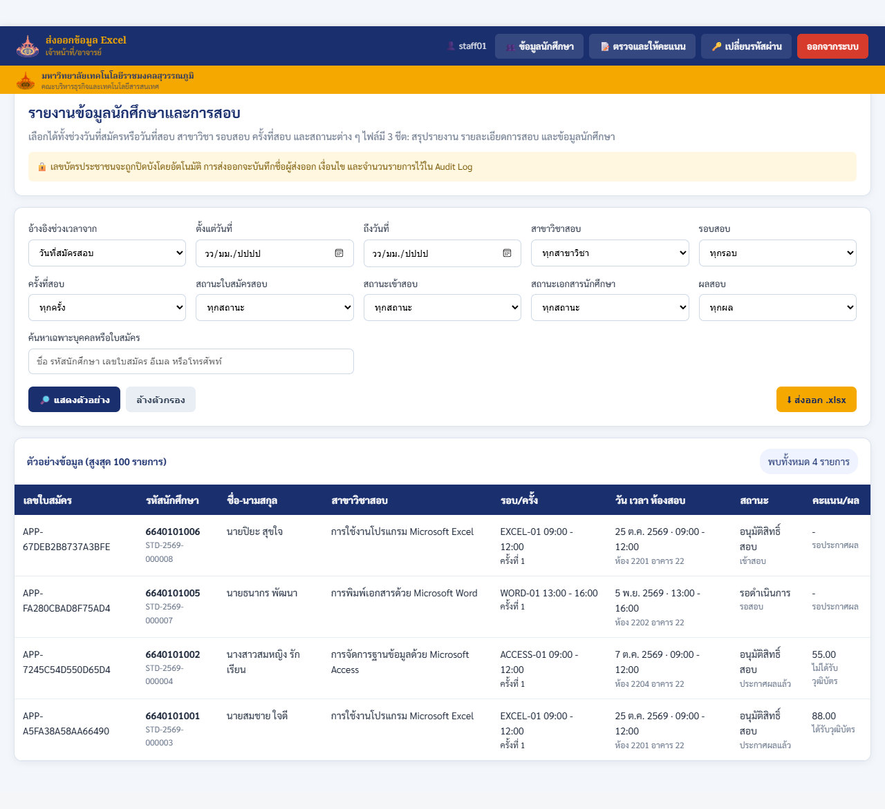

1. เลือกเงื่อนไข: อ้างอิงช่วงเวลาจาก (วันที่สมัคร/วันที่สอบ), ช่วงวันที่, สาขา, รอบสอบ, ครั้งที่สอบ, สถานะใบสมัคร, สถานะเข้าสอบ, สถานะเอกสาร, ผลสอบ, และคำค้น
2. กด **แสดงตัวอย่าง** เพื่อตรวจก่อน (แสดงสูงสุด 100 รายการ พร้อมจำนวนที่พบทั้งหมด)
3. กด **ส่งออก .xlsx** ระบบดาวน์โหลดไฟล์ที่มี 3 ชีต: **สรุปรายงาน**, **รายละเอียดการสอบ**, **ข้อมูลนักศึกษา**

หมายเหตุ: เลขบัตรประชาชนในไฟล์ถูกปิดบังเสมอ, ส่งออกได้สูงสุด 50,000 รายการต่อครั้ง (ถ้าเกินให้ระบุช่วงเวลา/สาขาให้แคบลง), ถ้ามีผู้อื่นกำลังส่งออกจำนวนมากพร้อมกันอาจขึ้นข้อความให้รอสักครู่แล้วลองใหม่ และทุกการส่งออกถูกบันทึกใน Audit Log (ผู้ส่งออก เงื่อนไข จำนวนรายการ)

---

## 5. สำหรับผู้ดูแลระบบ

ผู้ดูแลระบบเข้าสู่ระบบแล้วพบหน้า **ระบบบริหารจัดการ** แถบด้านบนมีทางลัด: **จัดการผู้ใช้งาน**, **ออกใบรับรอง**, **แก้ไขคะแนน**, **Audit Log**

### 5.1 ภาพรวมและสรุปผล

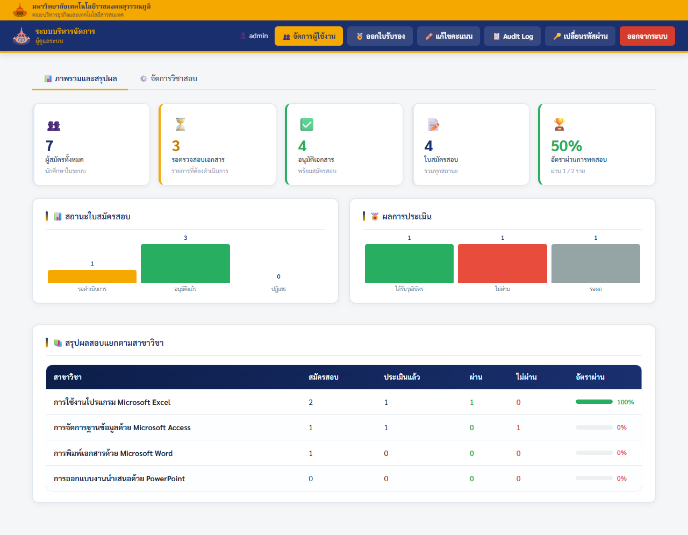

แสดงจำนวนผู้สมัครทั้งหมด รอตรวจสอบเอกสาร อนุมัติเอกสาร ใบสมัครสอบ อัตราผ่านการทดสอบ กราฟสถานะใบสมัครและผลการประเมิน และตารางสรุปผลแยกตามสาขาวิชา

### 5.2 จัดการวิชาสอบ

กดแท็บ **จัดการวิชาสอบ**

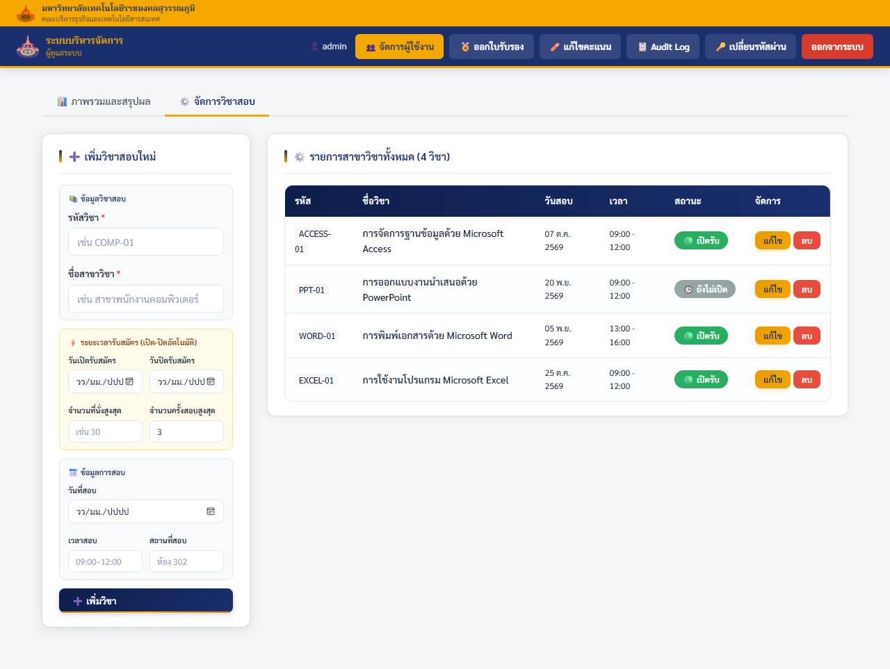

**เพิ่มวิชาใหม่** กรอกฟอร์มด้านซ้ายแล้วกด **เพิ่มวิชา**

| ช่อง | คำอธิบาย |
|---|---|
| รหัสวิชา / ชื่อสาขาวิชา | บังคับ รหัสวิชาห้ามซ้ำกับวิชาอื่น |
| วันเปิด/ปิดรับสมัคร | บังคับ ระบบเปิด-ปิดรับสมัครตามวันที่ให้อัตโนมัติ (วันปิดรับสมัครคือวันสุดท้ายที่ยังสมัครได้) |
| จำนวนที่นั่งสูงสุด | เต็มแล้วระบบไม่รับเพิ่ม |
| จำนวนครั้งสอบสูงสุด | 1–10 ครั้ง (รวมสอบซ่อม) |
| วันที่สอบ, เวลาสอบ, สถานที่สอบ | วันสอบต้องไม่ก่อนวันปิดรับสมัคร และต้องกรอกวันสอบ+สถานที่ก่อนจึงจะมีผู้สมัครได้ |

**แก้ไขวิชา** กดปุ่ม **แก้ไข** ที่แถวของวิชา ข้อมูลจะขึ้นในฟอร์มด้านซ้าย แก้แล้วกด **บันทึก**

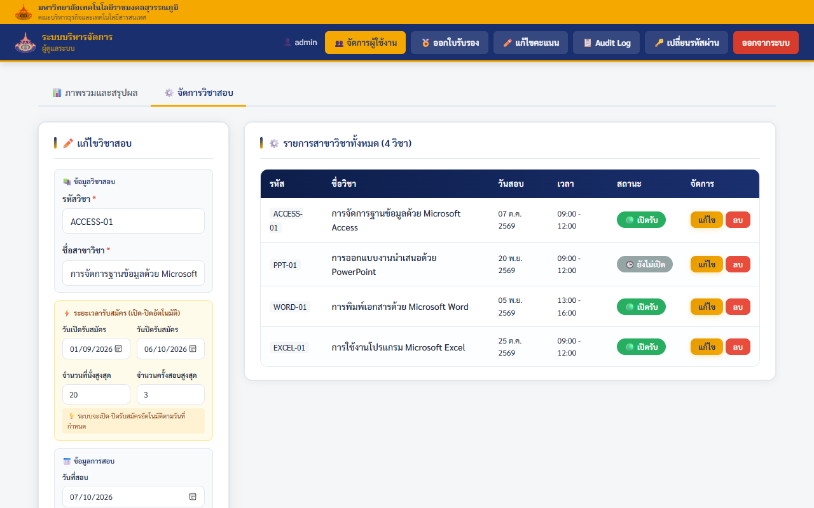

ข้อควรรู้เมื่อแก้ไข: ลดจำนวนที่นั่งต่ำกว่าจำนวนผู้สมัครที่มีอยู่ไม่ได้ / ลดจำนวนครั้งสอบต่ำกว่าที่มีคนสอบไปแล้วไม่ได้ / ลดคะแนนเต็มต่ำกว่าคะแนนที่บันทึกไว้ไม่ได้ / ถ้าเปลี่ยนวัน เวลา หรือสถานที่สอบ ใบสมัครที่ยังไม่ประกาศผลจะย้ายไปรอบสอบใหม่ให้อัตโนมัติ

**สถานะรับสมัคร:** ปุ่มสีในคอลัมน์ "สถานะ" (🟢 เปิดรับ / 🕒 ยังไม่เปิด / 🔴 ปิดรับ) คลิกเพื่อ **บังคับเปิดหรือปิด** ทันที โดยไม่ขึ้นกับวันที่ เมื่อมีการบังคับ จะมีปุ่ม **อัตโนมัติ** ปรากฏข้างๆ กดเพื่อกลับไปใช้สถานะตามวันที่ (อย่าลืมคืนค่าอัตโนมัติ มิฉะนั้นวิชาจะเปิดค้างเกินวันปิดรับสมัคร)

**ลบวิชา** กดปุ่ม **ลบ** ได้เฉพาะวิชาที่ยังไม่มีใบสมัคร

### 5.3 จัดการผู้ใช้งาน

กดปุ่ม **จัดการผู้ใช้งาน**

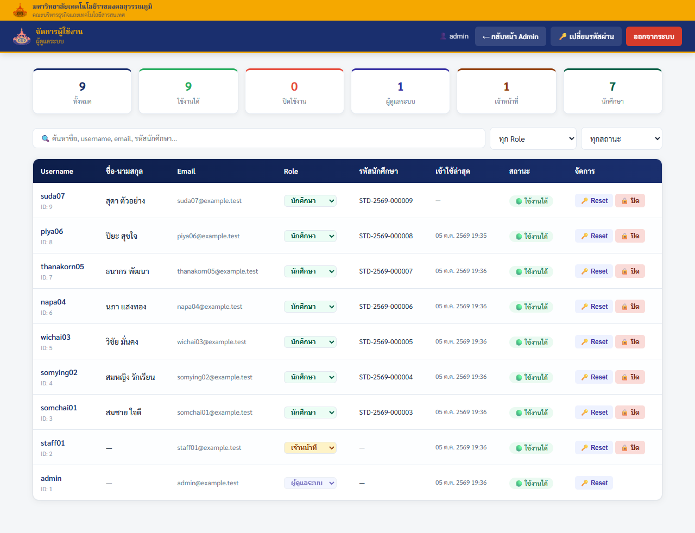

- การ์ดด้านบนสรุปจำนวนผู้ใช้ทั้งระบบ (ทั้งหมด / ใช้งานได้ / ปิดใช้งาน / ผู้ดูแล / เจ้าหน้าที่ / นักศึกษา)
- ค้นหาด้วยชื่อ username อีเมล รหัสนักศึกษา และกรองตามบทบาท/สถานะ แสดงหน้าละ 25 บัญชี (มีปุ่ม ก่อนหน้า/ถัดไป)
- **เปลี่ยนบทบาท:** เลือกจากเมนูในคอลัมน์ Role (เปลี่ยนบทบาทของตัวเองหรือผู้ดูแลคนสุดท้ายไม่ได้ และเปลี่ยนเป็นนักศึกษาได้เฉพาะบัญชีที่มีข้อมูลผู้สมัคร)
- **ปิด/เปิดบัญชี:** ปุ่ม 🔒 ปิด / 🔓 เปิด (ผู้ถูกปิดจะออกจากระบบทันที; บัญชีผู้ดูแลปิดผ่านหน้านี้ไม่ได้)
- **Reset รหัสผ่าน:** กดปุ่ม **Reset** กรอกรหัสผ่านใหม่สองครั้ง

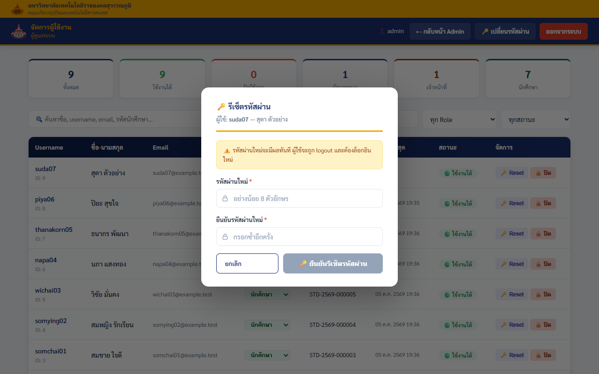

ผู้ใช้ที่ถูกรีเซ็ตจะถูกออกจากระบบทุกเครื่องและต้องเข้าด้วยรหัสใหม่ (รีเซ็ตรหัสของตัวเองผ่านหน้านี้ไม่ได้ ให้ใช้เมนู **เปลี่ยนรหัสผ่าน**) ทุกการกระทำถูกบันทึกใน Audit Log

### 5.4 ออกใบรับรอง (วุฒิบัตร)

กดปุ่ม **ออกใบรับรอง**

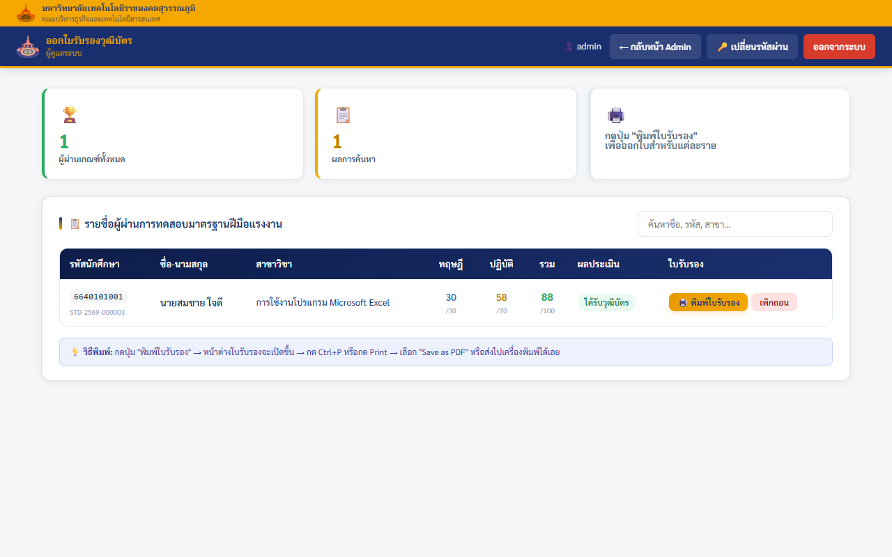

- **พิมพ์ใบรับรอง:** เปิดใบรับรองในหน้าต่างใหม่ (ต้องอนุญาต popup) กด Ctrl+P แล้วเลือก "Save as PDF" หรือพิมพ์
- **เพิกถอน:** ต้องระบุเหตุผล (3–255 ตัวอักษร) ใบรับรองจะใช้ไม่ได้และหน้าตรวจสอบสาธารณะแสดงว่าถูกเพิกถอน
- **ออกใหม่:** ปรากฏเมื่อใบรับรองถูกเพิกถอน จะได้เลขที่ใหม่ (ต่อท้าย -R2, -R3 …) และ **รหัสตรวจสอบใหม่** (ลิงก์/คิวอาร์เก่าใช้ไม่ได้อีก) ออกใหม่ได้เฉพาะเมื่อผลสอบปัจจุบันยังผ่านเกณฑ์

### 5.5 Audit Log

กดปุ่ม **Audit Log** มี 2 แท็บ

**แท็บ "การแก้ไขคะแนน"** แสดงทุกการบันทึก/แก้ไขคะแนน (ค่าเดิม → ค่าใหม่, ผู้แก้ไข, วันเวลา) กรองด้วยรหัสนักศึกษาและช่วงวันที่ และมีปุ่ม **Export CSV**

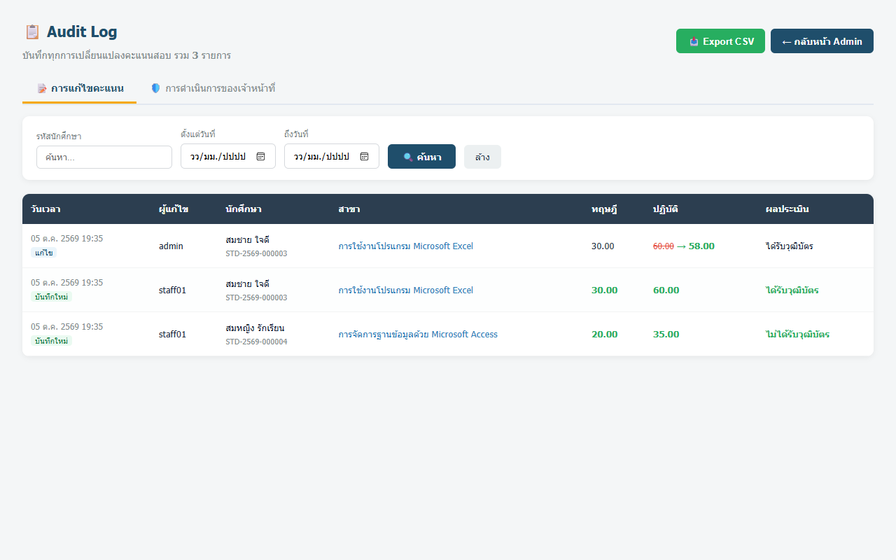

**แท็บ "การดำเนินการของเจ้าหน้าที่"** แสดงการกระทำสำคัญของเจ้าหน้าที่และผู้ดูแล เช่น เปิดดูเอกสาร/ข้อมูลนักศึกษา ตรวจเอกสาร เปลี่ยนสถานะ ส่งออกข้อมูล แก้ไขคะแนน จัดการวิชา ผู้ใช้ และใบรับรอง (หน้าละ 50 รายการ)

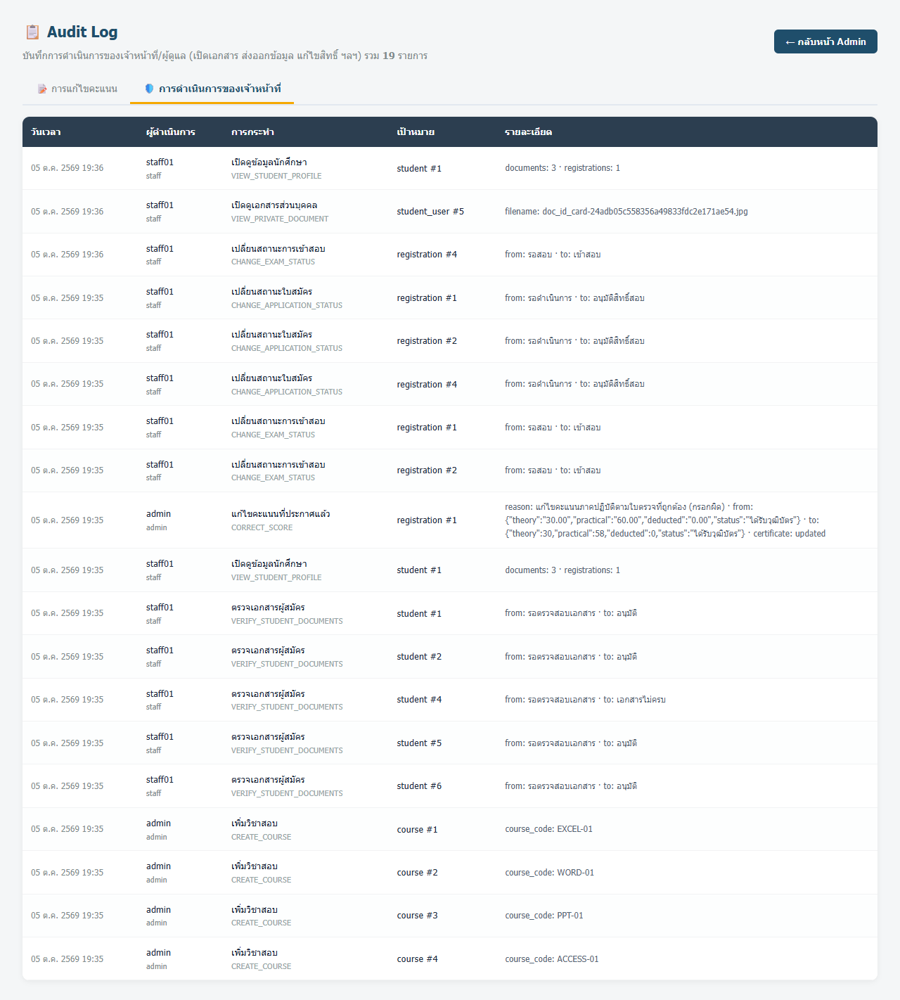

### 5.6 แก้ไขคะแนนที่ประกาศแล้ว

ใช้เฉพาะกรณีคะแนนที่ประกาศไปแล้วผิดพลาด กดปุ่ม **แก้ไขคะแนน** ค้นหารายการ (ชื่อ รหัส หรือเลขใบสมัคร) แล้วกด **แก้ไข**

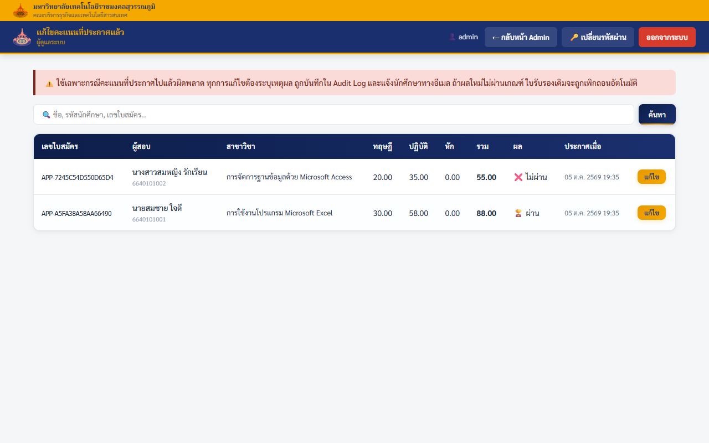

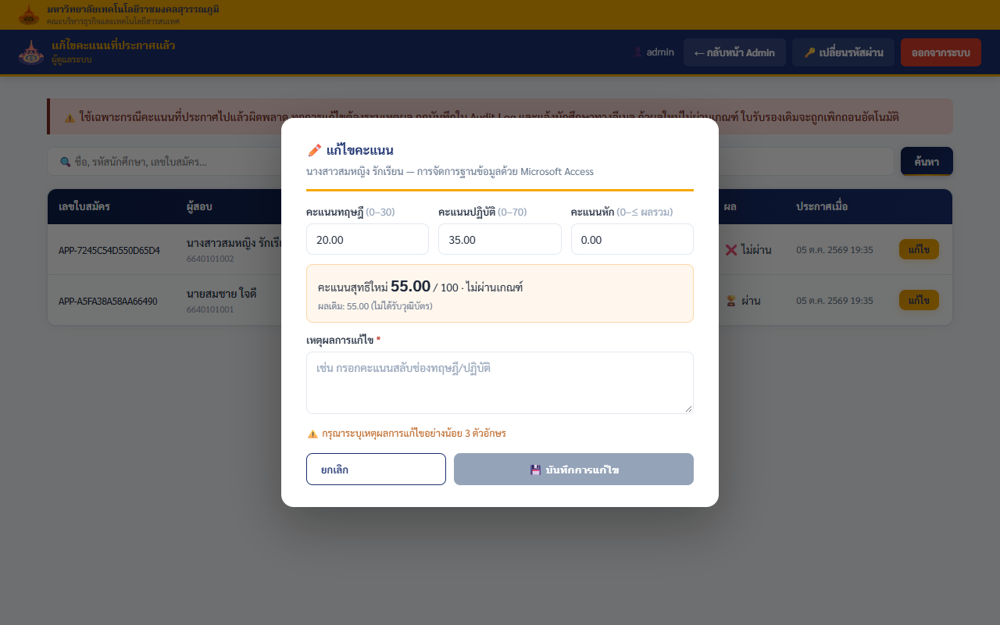

1. แก้คะแนนที่ผิด (ระบบคำนวณคะแนนสุทธิใหม่และแสดงเทียบกับผลเดิม)
2. **ระบุเหตุผลการแก้ไข** อย่างน้อย 3 ตัวอักษร (บังคับ ปุ่มบันทึกจะกดไม่ได้จนกว่าจะกรอก)
3. กด **บันทึกการแก้ไข** แล้วยืนยัน

ผลที่เกิดขึ้นอัตโนมัติ: บันทึกใน Audit Log ทั้งสองแท็บ (พร้อมเหตุผล) / แจ้งเตือนและส่งอีเมลให้นักศึกษา / ถ้าผลใหม่ **ยังผ่าน** ระบบปรับคะแนนในใบรับรองให้ตรงกัน / ถ้าผลใหม่ **ไม่ผ่านเกณฑ์** ใบรับรองเดิมถูกเพิกถอนอัตโนมัติ

---

## 6. การใช้งานบนโทรศัพท์มือถือ

ระบบปรับหน้าจอตามขนาดอุปกรณ์ นักศึกษาใช้งานครบทุกฟังก์ชันได้จากมือถือ

**หน้าเข้าสู่ระบบ** (ตารางวิชาที่เปิดรับสมัครอยู่ใต้ฟอร์ม)

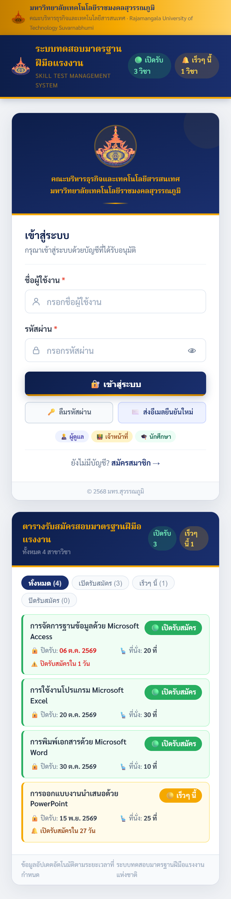

**แดชบอร์ดนักศึกษา** (บัตรเข้าห้องสอบเรียงเป็นแนวตั้ง)

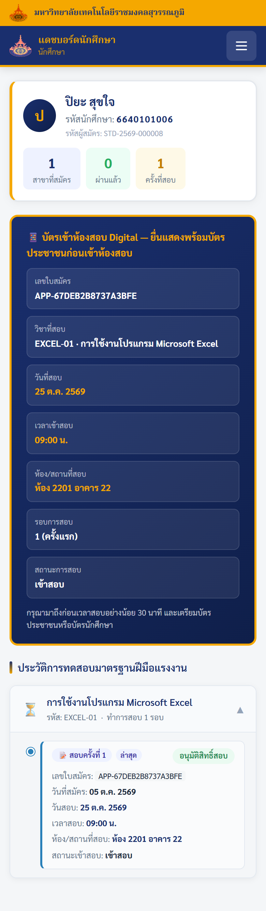

**เมนู** กดปุ่ม **☰** มุมขวาบนเพื่อเปิดเมนู (แสดงชื่อผู้ใช้ และปุ่มต่างๆ เช่น สมัครสอบ เปลี่ยนรหัสผ่าน ออกจากระบบ) กดอีกครั้งที่ปุ่ม **✕** เพื่อปิด

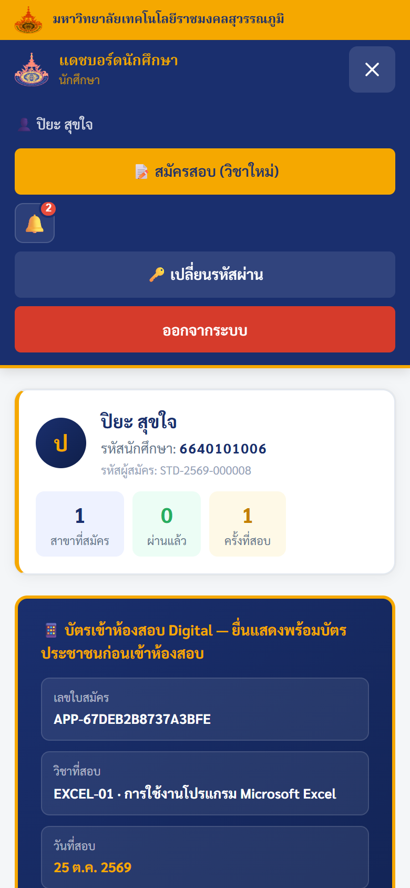

**หน้าเจ้าหน้าที่บนมือถือ** ใช้ดูข้อมูลและตัวเลขสรุปได้ แต่ตารางที่มีหลายคอลัมน์ต้องเลื่อนซ้าย-ขวา การคัดกรอง ตรวจเอกสาร และกรอกคะแนนจึงแนะนำให้ทำบนคอมพิวเตอร์หรือแท็บเล็ต

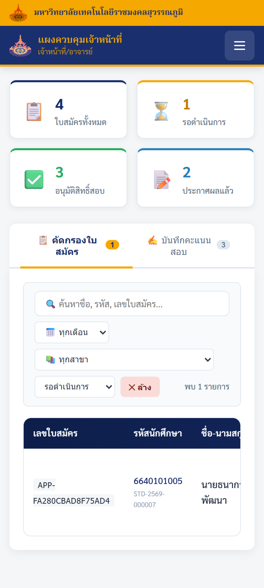

---

## 7. ปัญหาที่พบบ่อยและวิธีแก้

| ข้อความ/อาการที่พบ | สาเหตุ | วิธีแก้ |
|---|---|---|
| "กรุณายืนยันอีเมลก่อนเข้าสู่ระบบ" | ยังไม่ได้กดลิงก์ในอีเมลยืนยัน | เปิดอีเมลกดลิงก์ ถ้าไม่พบให้ตรวจโฟลเดอร์สแปมหรือใช้ **ส่งอีเมลยืนยันใหม่** |
| "ชื่อผู้ใช้หรือรหัสผ่านไม่ถูกต้อง" | พิมพ์ผิด | ตรวจตัวพิมพ์เล็ก/ใหญ่ ใช้ **ลืมรหัสผ่าน** ถ้าจำไม่ได้ |
| "พยายามเข้าสู่ระบบมากเกินไป กรุณารอ 15 นาที" | ใส่รหัสผ่านผิดหลายครั้ง | รอ 15 นาทีแล้วลองใหม่ (หรือใช้ลืมรหัสผ่าน) |
| "บัญชีนี้ถูกปิดใช้งาน" | ผู้ดูแลปิดบัญชี | ติดต่อผู้ดูแลระบบ |
| "เซสชันสิ้นสุดแล้ว กรุณาเข้าสู่ระบบใหม่" | เปลี่ยนรหัสผ่าน/บทบาท หรือถูกรีเซ็ตรหัสผ่าน | เข้าสู่ระบบใหม่ |
| "ลิงก์หมดอายุหรือถูกใช้แล้ว" | ลิงก์ยืนยัน (24 ชม.) หรือลิงก์ตั้งรหัสผ่าน (30 นาที) หมดอายุ/ใช้ไปแล้ว | ขอลิงก์ใหม่จากหน้าส่งอีเมลยืนยัน/ลืมรหัสผ่าน |
| "เลขบัตรประชาชนไม่ผ่านการตรวจสอบ" | ตัวเลขไม่ถูกต้องตามหลัก check digit | ตรวจเลขบัตรอีกครั้ง |
| "เลขบัตรประชาชนนี้ถูกลงทะเบียนแล้ว" / "อีเมลนี้ถูกใช้แล้ว" / "ชื่อผู้ใช้นี้ถูกใช้แล้ว" | เคยสมัครแล้ว | เข้าสู่ระบบแทน หรือใช้ลืมรหัสผ่าน |
| "ไฟล์มีขนาดเกิน 5 MB" / "รองรับเฉพาะไฟล์ JPG, PNG และ PDF" | ไฟล์ใหญ่หรือผิดชนิด | ย่อขนาดภาพหรือแปลงเป็น JPG/PDF |
| "เอกสารยังไม่ได้รับการอนุมัติ" | เจ้าหน้าที่ยังไม่ตรวจ หรือแจ้งว่าไม่ครบ | รอผลตรวจ หรือส่งเอกสารใหม่ตามแจ้งเตือน |
| "วิชานี้ไม่ได้อยู่ในช่วงเปิดรับสมัคร" | นอกช่วงวันที่เปิดรับสมัคร | รอรอบถัดไป หรือติดต่อผู้ดูแลระบบ |
| "จำนวนผู้สมัครเต็มแล้ว" | ที่นั่งเต็ม | ติดต่อเจ้าหน้าที่ |
| "คุณมีใบสมัครวิชานี้อยู่แล้ว" | สมัครวิชานี้ไปแล้ว | ดูสถานะที่แดชบอร์ด |
| เปิดใบรับรองไม่ได้ / หน้าต่างไม่เปิด | เบราว์เซอร์บล็อก popup | อนุญาต popup ของเว็บไซต์นี้ |
| "ผลถูกประกาศแล้ว เจ้าหน้าที่แก้ไขเองไม่ได้" | ประกาศผลแล้ว | แจ้งผู้ดูแลระบบให้แก้ที่หน้า "แก้ไขคะแนน" |
| ส่งออก Excel ขึ้นให้รอ | มีผู้อื่นกำลังส่งออกข้อมูลจำนวนมาก | รอ 1–2 นาทีแล้วลองใหม่ หรือจำกัดช่วงข้อมูลให้เล็กลง |
| กดปุ่มแล้วไม่มีอะไรเกิดขึ้น / หน้าขาว | เครือข่ายขัดข้อง หรือเวอร์ชันเก่าค้างในเบราว์เซอร์ | กด Ctrl+F5 (โหลดใหม่แบบล้างแคช) ถ้ายังไม่หาย แจ้งผู้ดูแลระบบพร้อมภาพหน้าจอ |

---

## 8. ภาคผนวก: ความหมายของสถานะและข้อกำหนดของระบบ

### 8.1 สถานะเอกสารของผู้สมัคร (นักศึกษา)

| สถานะ | ความหมาย |
|---|---|
| รอตรวจสอบเอกสาร | สมัครสมาชิกแล้ว รอเจ้าหน้าที่ตรวจ (สมัครสอบยังไม่ได้) |
| เอกสารไม่ครบ | เจ้าหน้าที่ให้แก้ไข ส่งเอกสารใหม่ได้ |
| อนุมัติ | เอกสารผ่าน สมัครสอบได้ |

### 8.2 สถานะใบสมัครสอบ

| สถานะ | ความหมาย |
|---|---|
| รอดำเนินการ | ยื่นใบสมัครแล้ว รอเจ้าหน้าที่อนุมัติสิทธิ์ |
| อนุมัติสิทธิ์สอบ | มีสิทธิ์เข้าสอบ (ได้บัตรเข้าห้องสอบ) |
| ปฏิเสธเอกสาร | ใบสมัครถูกปฏิเสธ (ติดต่อเจ้าหน้าที่ สมัครใหม่ได้ถ้ายังเปิดรับ) |

### 8.3 สถานะการเข้าสอบ

| สถานะ | ความหมาย |
|---|---|
| รอสอบ | อนุมัติสิทธิ์แล้ว ยังไม่ถึงวันสอบ/ยังไม่ยืนยัน |
| เข้าสอบ | เจ้าหน้าที่ยืนยันว่าเข้าสอบแล้ว (กรอกคะแนนได้) |
| ขาดสอบ / ยกเลิก | ไม่ได้เข้าสอบ (กรอกคะแนนไม่ได้ เจ้าหน้าที่แก้กลับเป็น "รอสอบ" ได้ก่อนประกาศผล) |
| ประกาศผลแล้ว | บันทึกคะแนนและประกาศผลเรียบร้อย |

### 8.4 สถานะวิชาสอบ

| สถานะ | ความหมาย |
|---|---|
| ยังไม่เปิดรับสมัคร (เร็วๆ นี้) | ยังไม่ถึงวันเปิดรับ |
| เปิดรับสมัคร | อยู่ในช่วงวันเปิด–ปิดรับ (หรือผู้ดูแลบังคับเปิด) |
| ปิดรับสมัคร | พ้นวันปิดรับ (หรือผู้ดูแลบังคับปิด) |

### 8.5 ผลการประเมิน

คะแนนสุทธิ = คะแนนทฤษฎี + คะแนนปฏิบัติ − คะแนนที่หัก
- **ได้รับวุฒิบัตร** เมื่อคะแนนสุทธิ ≥ 70
- **ไม่ได้รับวุฒิบัตร** เมื่อคะแนนสุทธิ < 70

### 8.6 ข้อกำหนดสำคัญของระบบ

| เรื่อง | ข้อกำหนด |
|---|---|
| ไฟล์เอกสาร | JPG / PNG / PDF ไม่เกิน 5 MB ต่อไฟล์ (ระบบตรวจเนื้อหาไฟล์จริง ไม่ใช่แค่นามสกุล) |
| รหัสผ่าน | ยาวอย่างน้อย 8 ตัวอักษร และไม่เกิน 72 ไบต์ |
| อายุของการเข้าสู่ระบบ | 15 นาทีต่อรอบ ต่ออายุอัตโนมัติขณะใช้งาน และจำได้สูงสุด 7 วัน (ปิดแท็บแล้วเปิดใหม่ ระบบกู้การเข้าสู่ระบบให้เอง ไม่ต้องกรอกรหัสซ้ำ จนกว่าจะออกจากระบบ) |
| ลิงก์ในอีเมล | ยืนยันอีเมล 24 ชั่วโมง / ตั้งรหัสผ่านใหม่ 30 นาที (ใช้ได้ครั้งเดียว) |
| ข้อมูลส่วนบุคคล | เก็บเท่าที่จำเป็นต่อการสมัคร จัดสอบ และออกวุฒิบัตร (ผู้สมัครต้องให้ความยินยอมตอนสมัคร) เอกสารที่แนบเก็บแบบไม่เปิดสาธารณะ เจ้าหน้าที่เปิดดูได้และทุกครั้งมีบันทึก |
| การตรวจสอบย้อนหลัง | การเปลี่ยนแปลงคะแนน สถานะ การเปิดดูเอกสาร การส่งออก และการจัดการผู้ใช้/วิชา/ใบรับรอง มีบันทึกใน Audit Log |

### 8.7 ติดต่อผู้ดูแลระบบ

เมื่อพบปัญหาที่คู่มือนี้ไม่ครอบคลุม ให้แจ้งผู้ดูแลระบบพร้อม (1) ชื่อผู้ใช้ (2) ภาพหน้าจอที่เห็นข้อความ (3) วัน-เวลาที่เกิดปัญหา และห้ามส่งรหัสผ่านให้ผู้ใด
